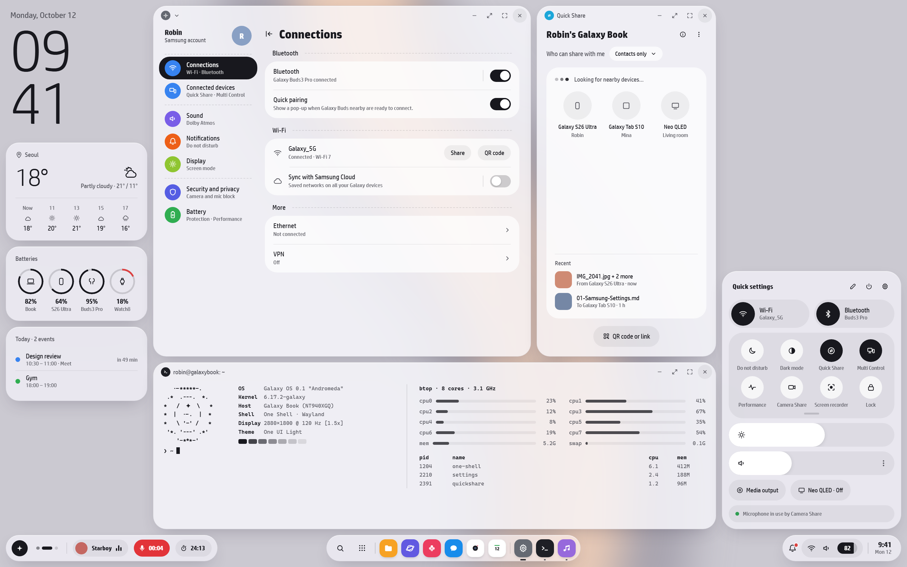

# OneUI OS

A lightweight Linux for Galaxy Book laptops that looks and feels like Samsung made it, from the boot logo and first-run setup to the desktop. It's built for people coming from Windows.

*Design concept (`mockup/`). The OS is being built towards this.*

## What it is

- **Base:** Fedora Kinoite 44 (KDE Plasma 6, atomic) via Universal Blue. Updates download in the background, apply on reboot, and can be rolled back from the boot menu.
- **Look:** One UI 8 / DeX style. The taskbar is three floating pills, with frosted glass, colours taken from the mockup's design tokens, the Pretendard font (Latin and Hangul), and scheduled dark mode.
- **Setup:** a phone-style first boot. You see the Samsung firmware logo, then a "Hello / 안녕하세요" greeting, then account, Wi-Fi, and a page that explains the Galaxy features.
- **Galaxy Book support:** keyboard backlight, performance modes (Fn+F11), battery charge limit, camera/mic block, the Book4/5 speaker amp driver, the Book4 mic fix, and the libcamera webcam stack.
- **Galaxy continuity on Linux:** Quick Share (Packet), phone link (KDE Connect), and Galaxy Buds Manager.

## Repository layout

| Folder | What's inside |
|---|---|
| [`os/`](os/) | The OS itself: Containerfile, theme, Galaxy Book fixes, test VM scripts, and **the full step-by-step guide** ([os/README.md](os/README.md)) |
| [`mockup/`](mockup/) | The UI concept: HTML/CSS mockup and renders (light/dark; desktop, finder, app drawer, notifications, overview) |
| [`docs/`](docs/) | Engineering notes on Samsung's Windows apps (Settings, Quick Share, Continuity, Device Care…), used to decide what to replace and how |
| [`.github/workflows/`](.github/workflows/) | `build.yml` builds the OS image daily and on push. `build-iso.yml` builds the installer ISO on demand. |

## Quick start

1. Add the module signing key as a repo secret: `gh secret set MOK_KEY < os/mok.key`. The key file stays local and is never committed.
2. **Actions → Build image**, then set the `oneui-os` package to **Public** under your GitHub Packages.
3. **Actions → Build ISO**, then download `oneui-os-iso`.
4. Try the look first without building anything: run `os/test/vm.ps1` in an admin PowerShell (Hyper-V).

Details, troubleshooting and the Samsung Settings → OneUI OS feature map are in **[os/README.md](os/README.md)**.

## Status

Version 0.1. **Not build-tested yet:** the first Actions run is the real test. The theme files were checked on Fedora KDE 44 in a VM ([docs/ui-parity.md](docs/ui-parity.md)). Still to do: a One UI quick-settings panel, a Galaxy Book settings page, a live ISO, and Camera Share.

## Legal

"One UI", "Galaxy" and "Samsung" are Samsung trademarks. This is an unofficial personal project and isn't affiliated with Samsung. Rename it before distributing ISOs. No Samsung fonts, logos, binaries or colour profiles are included. The speaker driver is from [Andycodeman/samsung-galaxy-book-linux-fixes](https://github.com/Andycodeman/samsung-galaxy-book-linux-fixes) (GPL-2.0).
