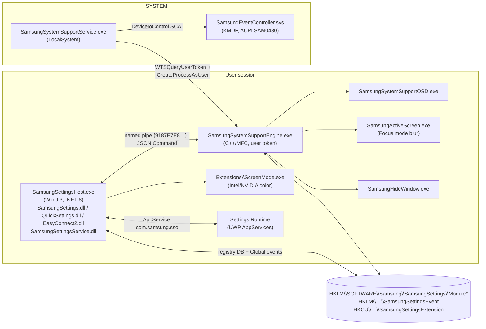

# 01 — Samsung Settings (Settings 1.5, Settings Runtime, System Support Engine)

## 1. Purpose

Samsung Settings is the Galaxy Book control panel for hardware/firmware features Windows does not expose: performance/fan modes, battery protection, keyboard backlight, screen color modes, Vision Booster, HDR+, camera/mic block, Fn-lock, Hide Window, Focus Mode, Studio Mode, Wi-Fi/Bluetooth cloud sync, Galaxy Buds auto-switch, USB charging, auto-boot on lid open, Labs (human presence detection), and a launcher hub for other Galaxy apps (Quick Share, Camera Share, Multi Control, Storage Share, SmartThings, Call & Text, Second Screen).

It is a **three-tier system**:

1. **UI** — `SamsungSettings1.5` MSIX (WinUI 3, .NET 8).
2. **Per-session engine** — `SamsungSystemSupportEngine.exe` (native C++/MFC, launched into the user session) plus helpers (OSD, ActiveScreen, HideWindow, extension launcher).
3. **SYSTEM service** — `SamsungSystemSupportService.exe`, shipped as a Windows Update DCHU *software component* bound to the ACPI SCAI device, which talks to firmware through `SamsungEventController.sys`.

A fourth piece, **Samsung Settings Runtime** (`SamsungSettingsRuntime_7.0.6.0`, .NET Native UWP), hosts background AppServices for Samsung Account, Samsung Cloud sync and BLE triggers.

## 2. Packaging & deployment

| Piece | Identity / location | Version | Runtime |
|---|---|---|---|
| UI app | `SAMSUNGELECTRONICSCO.LTD.SamsungSettings1.5_8.0.13.0_x64__3c1yjt4zspk6g` | 8.0.13.0 | .NET 8 self-contained (apphost `SamsungSettingsHost.exe` + `createdump.exe`), WinUI 3 / Windows App SDK |
| Runtime | `SAMSUNGELECTRONICSCO.LTD.SamsungSettingsRuntime_7.0.6.0_x64__3c1yjt4zspk6g` | 7.0.6.0 | UWP, .NET Native 2.2 (`SamsungSettingsRuntime.dll` native image) |
| Backend extension INF | `sfourswext0428v15.inf` (Class=Extension) → `ACPI\SAM0428`, `SAM0429`, `SAM0430`; B2B variant `ACPI\SAMB430` | 7.1.7.0 (2025-10-22) | — |
| Backend component INF | `sfourswcomp15.inf` (Class=SoftwareComponent) → `SWC\SAM0428&S03_SSYS` | 8.0.13.0 (2026-05-29), `PnpLockdown=1` | native C++ (MSVC, MFC) |
| Kernel driver | `samsungeventcontroller.inf` → `ACPI\SAM0430`, `ACPI\SAMB430`; KMDF 1.27 | 1.1.0.6 | KMDF |

Files from `sfourswcomp15` (installed to DriverStore, `DestinationDirs=13` i.e. run-from-DriverStore): `SamsungSystemSupportService.exe`, `SamsungSystemSupportEngine.exe`, `SamsungSystemSupportOSD.exe`, `SamsungActiveScreen.exe`, `SamsungHideWindow.exe`, `SettingsExtensionLauncher.exe`, `SECColor.dll`, `LanguageResource.ini`, MFC/VC runtimes. The B2B hardware ID maps to an `_Install_NoSoftware` section (service without UI helpers).

Design consequence: the hardware-facing half ships through **Windows Update driver channels** keyed on an ACPI ID, so it is present even if the Store app is not installed; the Store app is a pure front-end that can be updated independently. `SamsungSystemSupportEngine` has a hard-coded Store PDP fallback `ms-windows-store://pdp/?productid=9P2TBWSHK6HJ` when the UI app is absent.

### Manifest highlights (Settings 1.5)

- Capabilities: `runFullTrust`, `unvirtualizedResources`; `uap5:DriverDependency` (declares the DCHU component).
- Protocols: `samsungsettings15:`, `com.ssr.sawinui:`, `ssr.wifisync:`, `bixby-ssettings:`, `samsung-diagnosticdata:`, `settings.ext.modulescreenmode:` (→ `Extensions\ScreenMode.exe`).
- AppService `com.samsung.sso` (multi-instance) → `AppServices.SAAppServiceReceiver`.
- Background task `AppServices.BLEAdvertisementBackgroundTask` (Bluetooth + deviceConnectionChange) — Buds swift-pairing (`OnAdvListener`, `OnSwiftParingListener`).
- Toast activator COM server CLSID `EDE02CD1-33B4-43F4-8559-B8D961D11F48` → `SamsungSettingsHost.exe ----AppNotificationActivated:`.
- Publisher cache folders: `WifiShare`, `SamsungSettingsRunTime`.

### Manifest highlights (Settings Runtime)

- Capabilities: `runFullTrust`, `internetClient`, `userSystemId`, `smbios`, `systemManagement`, `bluetooth`.
- AppServices: `com.samsung.sso`, `samsung.sa` (`SAAppServiceForSS`), `samsung.sca` (`SCAAppServiceForSS`), `samsung.backgroundTask` (`BLEAppServiceForSS`), `com.samsung.cloud.sync.v2` (`SamsungCloudAppService`).
- `windows.preInstalledConfigTask` / `windows.updateTask` → `BackgroundTask.DataCheckBackgroundTask` (runs at OEM preinstall and app update).
- Protocols `com.samsung.ssr.redirect:` and `samsung.sca.service:` (→ `DesktopApp\AccountAppLauncher.exe`, .NET Framework stub).

## 3. Architecture

### Process roles (observed from source-path strings and exports)

| Process | Role | Key observed symbols |
|---|---|---|
| `SamsungSystemSupportService.exe` | SCM service. Heart-beat; launches engine into the active console session with the user's token (`WTSQueryUserToken`, `CreateEnvironmentBlock`); watches power, HID, USB, Bluetooth, raw input; owns SCAI device. | `SamsungSystemSupportService::OnStart/OnEvent/OnHeartBeat`, `RunExpansionPack`, `GetExpStatus`, `SystemPowerEventHandler::{OnMonitorOn,OnResume,CheckBiosVersion}`, `ScanCodeEventHandler`, `UsbHidEventHandler`, `ScaiEventHandler`, `BluetoothPortDeviceEventHandler`, `FileUtil::VerifySamsungSign`, `CreateNamedPipeW`, `GetNamedPipeClientProcessId` |
| `SamsungSystemSupportEngine.exe` | Per-user module host and event bus: executes module commands, writes the registry DB, raises toasts/OSD/popups, launches Settings, subscribes to Windows Event Log. | `SettingsEventHandler::InvokeEvent(Database/Extension/System)`, `SettingsEventHelper::{Toast,ClearToast,OSD,Popup,Refresh}`, `AppUtil::LaunchSamsungSettings[ByActive]`, `WindowEventLogListener::{TryPrevSettingsLauchEvent,TryHibernateEvent,TrySettingsModify}`, `SamsungAccountEventListener`, imports `wlanapi`, `PowerWrite*ValueIndex`, `QueryDisplayConfig`, `WcsGetDefaultColorProfile`, `SetupDiChangeState`, `EvtSubscribe`, RPC client/server stubs |
| `SamsungSystemSupportOSD.exe` | On-screen display for hot-key events (e.g. `OSD_BLOCK_CAM_OFF`). | `OSDHandler::SetOSDId` |
| `SamsungActiveScreen.exe` | Focus Mode: blurred background around active window. | `FocusModeState.cpp`, `BlurBackgound`, `CSamsungActiveScreenDlg::OnDisplayChange` |
| `SamsungHideWindow.exe` | "Hide Window" privacy feature: hotkey to cover/hide windows with background. | `HideWindowLibrary\{HideWindow,HideWindowControl,BackgroundWnd,KeyboardEventHandler}.cpp` |
| `SettingsExtensionLauncher.exe` | Launches Quick Settings (`-QuickSettings-`), app popups (`-AppPopup-`). | strings in engine |
| `Extensions\ScreenMode.exe` | Display color pipeline per GPU vendor. | `ScreenMode\{ColorGPUCommon,ColorIntel,ColorNvidia,ModuleScreenMode}.cpp` |
| `RestartAgent.exe` | Restarts the packaged app after updates (`\dev\RestartAgent\main.cpp`). | — |
| `SamsungSettingsHost.exe` | UI host; `Program.Main`, `App.OnLaunched`, `AppNotice` window (privacy notice). | |

Build provenance strings: `C:\Git\Actions\Runner01\_work\SamsungSettings_6\…` (GitHub Actions runner) and `C:\qba_8814\workspace\SAMSUNG_SETTINGS_6\RBS\…` (second CI) — two pipelines build parts of the same product.

## 4. Component engineering (UI tier)

### 4.1 Assemblies

| Assembly | Purpose | REA Evidence |
|---|---|---|
| `SamsungSettingsHost.dll` 8.0.13.0 | App entry, XAML metadata, notice window | `ev_0809c16db7307ee589dea2598f4b1e69c4c8fbae5f5f29068f964d6244125392` |
| `SamsungSettings.dll` (4.7 MB, 598 types) | Main UI: pages, 54 view models, navigation, search | `ev_18607f3ba17a1cf0941d83feb2fe69244d48b3b54afd9daf28adfce777a21ae2` (sha256 `1fe27af7…`) |
| `SamsungSettingsService.dll` | In-app background components (toasts, cloud/Wi-Fi sync, analytics, optional packages, Bixby) | `ev_3f7315b620df0ee971b5a4fd0cd89d45c7dcfa6176031b4ed70a878051f923c7` |
| `ExtensionCommon.dll` | Shared helpers, MUI strings, user agreement, Buds registry watcher | `ev_49048cb59b30c79050d1732047eb4703fb45fdc51e181e5eaa89ae1b92919b49` |
| `SettingsSDK.dll` | Managed half of the module/IPC/registry-DB SDK | (mddump) |
| `QuickSettings.dll` | Quick Settings flyout panel (`QuickSettingsPannel`, `BlurredBackdrop`) | `ev_ecff7fdcedf3c1b200e30d2e42da744114d1053d3e12f156f25702e9d74ba134` |
| `EasyConnect2.dll` | Galaxy Buds connection controller, multipoint switch popup, SPP status; P/Invokes `DllBudsMsgFmt.DLL`, `bthprops.cpl` | `ev_2f5d53b004799a87f055c07cc7f859ffe7ebb961d944d43e5a6d64516546be0b` |
| `AppPopup.dll`, `AppServices.dll` | Popup windows; WinRT-authored background tasks | — |
| `Samsung.OneUI.WinUI.dll` | One UI design system controls | — |
| `Intel.Cst.Ipc.dll` | Intel Context Sensing Technology IPC (human presence) | — |
| `Microsoft.ML.OnnxRuntime`, `Lokad.Tokenizers`, `NumSharp` | On-device semantic search | — |
| `CoreAudio.dll`, `ManagedNativeWifi.dll`, `QRCoder` | Audio endpoints, WLAN, Wi-Fi share QR | — |

REA classifies the Samsung assemblies as `cpp-cli-mixed` (native code present inside the CLI image). With TFM `.NETCoreApp v8.0` this is consistent with ReadyToRun precompilation rather than C++/CLI — *inference*.

### 4.2 Module model

Every feature is a **module** identified by name (`ModuleScreenMode`, `ModulePerformance`, `ModuleProtectBattery`, …). Contracts (`SettingsSDK.Module`):

- `IModule { Initialize, GetData, SetData, SendData }`; `AbstractModule` adds `IsSupport, OnLaunch, OnQuit, OnGet/SetOnOff, OnGet/SetValue, OnGet/Set/SendData, Update*, Retrive*`.
- `ModuleProxy` forwards calls to the engine; `ModuleFactory.Get(name)`; `ModuleExtension` provides async wrappers (`GetOnOffAsync`, `SetValueAsync`, …).
- `Command` (`FromJson/GetString`) — JSON command envelope with `ModuleActionType` (Support / OnOff / Value / Data …).

UI side: `ViewService.ConfigVMs/ConfigPages/CreateViewModel` builds a page→content→VM map; each content VM implements `IContentVM { ModuleName, Support, GetCategoryDesc, OnActive/OnInactive, OnActiveDetail/OnInactiveDetail }`. `ContentVmExtension.SupportWithCache` caches `Support` probes so unsupported hardware features are hidden.

### 4.3 IPC & integration contracts

| Channel | Name / key | Direction | Notes |
|---|---|---|---|
| Named pipe | `\\.\pipe\{9187E7E8-51A8-473D-A0D5-ED2B2E7D0770}_<Name>` (observed live: `_SamsungSystemSupportEngine`, `_SamsungSettingsService`, `_EasyConnect`; `TestSamsungSystemSupportEngine` for test builds) | UI/helpers ↔ engine | `PipeNameManager.GetEngineName/GetName`; JSON commands; server reads `GetNamedPipeClientProcessId` → path → `VerifySamsungSign` (Authenticode signer must be "Samsung Electronics Co., Ltd."). |
| Named event | `Global\{990E677A-CAE1-45F2-A19F-8E9649B3AB7F}` | engine → apps | `AppClose` / refresh signalling (`AppRefreshListener.CreateWaitEvent`). Engine SDDL for refresh event: `D:(A;;GA;;;BA)(A;;GA;;;SY)(A;;0x00100002;;;AU)`. |
| Named event | `Global\{9F04C746-91CF-4E51-B8A0-F7C34B126477}` | engine ↔ apps | `SettingsEventHandler` wait handle for event DB. |
| Registry DB (RO/RW) | `HKLM\SOFTWARE\Samsung\SamsungSettings\Module<Name>` | engine writes, UI reads | Values `Support`, `OnOff`, `Value`, plus module-specific keys (see §5). `SettingsDBFactory.GetRoDB/GetRwDB`. |
| Registry event queue | `HKLM\SOFTWARE\Samsung\SamsungSettingsEvent` | engine → UI | Value name = FILETIME ticks, data = JSON `{"EventType":"System","Key":"BatteryChange","Name":"BatteryChange","Val":""}` (observed). Event types: `Database`, `Extension`, `System`; system keys include `BatteryChange`, `SCAI` (Key = SCAI event code, e.g. `97`), `MonitorOn/Off`, `LidClose`, `ScanCode`, `DeviceArrival`, `DeviceRemoveComplete`, `SystemChange`, `SamsungAccountChange`, `WindowEventLog`, `Bluetooth`, `BluetoothPort`, `DealyedStartup`, `Convertible`. |
| Extension DB | `HKCU\SOFTWARE\Samsung\SamsungSettingsExtension\{AdvInfo, BudsDeviceInfo, ModuleDisplayColor, ScanResponseInfo}` | UI/engine | Buds data watched via WMI `RegistryTreeChangeEvent` on `HKEY_USERS\<sid>\SOFTWARE\Samsung\SamsungSettingsExtension\BudsDeviceInfo`. |
| AppService | `com.samsung.sso` | Account ↔ Settings | Sign-in broadcast; `SAAppServiceReceiver.OnRequestReceived`. |
| Protocol | `samsungsettings15:<page>` | any → UI | Engine deep-links (`LaunchUri`, `ApplicationActivationManager.ActivateApplication`). |
| Device | SCAI (`Samsung System Event Controller`) | service/engine → driver | `ScaiEventHandler`, `SCAIHelper`; `WaitForScaiReady`; identifiers `ScaiHwId`. |
| Machine Settings Runtime AppServices | `samsung.sa`, `samsung.sca`, `samsung.backgroundTask`, `com.samsung.cloud.sync.v2` | Account/Cloud ↔ Settings | used by Wi-Fi/BT cloud sync. |

Scan-code/hot-key vocabulary handled by the engine (observed strings): `SCAN_SETTINGS`, `SCAN_BLOCK_CAMMIC`, `SCAN_FN_LOCK_ON/OFF`, `SCAN_KEYBOARDBACKLIGHT_TOGGLE`, `SCAN_TOUCHPAD_ON/OFF`, `SCAN_BLEPLUS`, `SCAN_BATTERYWARNING`, `SCAN_BATTERY_REPLACE_MSG`, `SCAN_BATTERY_TOAST_ON/OFF`, `FAN_FNKEY`, `FAN_HIGHTEMP`, `TABLE_ON/OFF` (tablet posture), `AC_IN_DAYS`, `BATTERY_COOLDOWN_ENTER/LEAVE`, `RESOURCE_MONITOR`, `SCREENMODE`, `EXTERNALBATTERY`, `WINDOWSLOCKON/OFF`, and USB-keyboard variants `USB_SETTINGS`, `USB_FNLOCK_ON/OFF`, `USB_KEYBOARDBACKLIBHT`, `USB_BATTERY_IMBALANCE_ERROR`, `USB_BATTERY_PERMANENT_ERROR`.

## 5. Data & state

Observed module registry (HKLM, values on this host):

| Module | Notable values |
|---|---|
| `ModuleSystem` | `Version=8.0.13.0`, `CheckSingleBom=1`, `SupportComputerInfo=1` |
| `ModulePerformance` | `Value=2`, `ModeList=["2","1","0","3"]`, `TabletMode`, `PreEffectivePowerMode=4`, `WindowsPowerOption=Balanced` |
| `ModuleProtectBattery` | `OnOff`, `Value=90` (charge cap %), `DC5DaysToastCount`, `CurrentState` |
| `ModuleScreenMode` | `Value`, `ColorModeList=["0","1","2","3","5"]`, `DPST`, `DPSTOnOff`, `Amoled`, `Colortone`, `ColortoneValue`, `BlackEqualizerLevelValue`, `HdrPlusOnOff`, `ColorWithRecord/WithoutRecord` |
| `ModuleColorEngine` | `Interface=6`, `ColorEngineInstalled=1`, `VisionBooster`, `HdrPlus`, `DisplaySharpnessSupport`, … |
| Others present | `ModuleAccessCamMic`, `ModuleAutoBoot`, `ModuleBatteryDegradationNoti`, `ModuleBlockCamMic`, `ModuleContinueApps`, `ModuleDolbyAtmos`, `ModuleEasyConnect`, `ModuleFocusMode`, `ModuleHdrPlus`, `ModuleHideWindow`, `ModuleKeyboardBacklightLevel`, `ModuleNearByDevice`, `ModuleQuickSettings`, `ModuleUSBCharging`, `ModuleWiFiSync` |

Root values: `ModelType=NotePC`, `Manufacturer`, `BIOSVersion`, `EngineVersion`, `AppVersion`, `MigrationComplete`, `LastUpdate` (Unix seconds).

Files: `C:\ProgramData\Samsung\SamsungSettings\` — `GalaxyBLESettingsV2.BLE`, `GalaxyBTSettingsV2.BT` (Buds BLE/BT setting blobs), `<device name>_BudsBattery.png` (rendered battery images, filenames include user-chosen device names). Engine log `…\SamsungSettingsEngine` with `l_bak.log` rotation. In-app files `\btSync.txt`, `\wifiSync.txt`, `\WiFiList.txt`, `\profile.png`, `\debug.txt`, `ExtensionCommon\UserAgreement\Versions.json`.

Engine also reads/writes: `SYSTEM\CurrentControlSet\Services\ConsultingModeService` (store-demo "consulting mode"), `SYSTEM\CurrentControlSet\Control\PriorityControl` (performance mode), NIC class key `{4D36E972-…}` (Wi-Fi), `HARDWARE\DESCRIPTION\System\BIOS`, `S-1-5-19\Software\Samsung\Phone` (`PhoneVersion`).

## 6. Feature catalogue (UI ↔ module ↔ backend)

| UI page / VM | Module | Backend mechanism (observed) |
|---|---|---|
| Battery & performance → `PerformanceModeVM` (High perf / Optimized / Low noise / Fan off / Fan max) | `ModulePerformance` | Engine: `PowerSetActiveScheme`, `PowerWrite{AC,DC}ValueIndex`, effective-power-mode notifications; EC via SCAI. Tablet-mode variant `PerfModeTablet`. |
| `ProtectBatteryVM` (charge limit, extended) | `ModuleProtectBattery` | EC charge threshold; toast after 5 days on AC (`AC_IN_DAYS`). |
| `BatteryInformationVM` | — | cycle count, typical/rated capacity, health, manufacture/first-use date. |
| `KeyboardBacklightVM` (level, idle timeout 30 s–10 min, ALS) | `ModuleKeyboardBacklightLevel` | engine values `SupportALS`, `IdleTime`, `IdleOnOff`; HID (`KbdHIDDev.cpp`). |
| Display → `ScreenModeVM`, `ColorToneVM`, `VisionBoosterVM`, `HdrPlusVM`, `ClarityVM`, `DisplayPowSavingVM` (DPST), `ColorEngineInstallVM` | `ModuleScreenMode`, `ModuleColorEngine` | `ScreenMode.exe` (Intel IGCL / NVIDIA paths), ColorEngine service (doc 12). Modes: Auto, Vivid/Dynamic, Natural, Standard, sRGB, DCI-P3, Adobe RGB, AMOLED native, Photo, Reading. |
| Security & privacy → `BlockCamMicVM`, `BlockCamVM`, `BlockMicVM`, `SendDiagnosticDataVM` | `ModuleBlockCamMic` | engine `SetupDiChangeState` (disable devices) + OSD `OSD_BLOCK_CAM_OFF`; hot-key `SCAN_BLOCK_CAMMIC`. |
| `HideWindowVM` (shortcut, opacity, background) | `ModuleHideWindow` | `SamsungHideWindow.exe` |
| `FocusModeVM` (timer 0/10/20/30/60) | `ModuleFocusMode` | `SamsungActiveScreen.exe` blur |
| `StudioModeVM` | — | `SETTINGS_STUDIOMODE_STATUS` |
| `HpdVM` / `LabsVM` (human presence: lock on leave) | — | Intel CST IPC (`Intel.Cst.Ipc`), `HumanPresenceChannelWriter`, `IFeatureCallback` |
| Connections → `WifiVM` (share via QR / Quick Share, cloud sync), `WiredNetworkVM` (static IP profiles), `EasyBluetoothConnectionVM`, `AutoSwitchBudsVM`, `GalaxyBudsVM` | `ModuleWiFiSync`, `ModuleEasyConnect` | `WifiShare` P/Invokes `wlanapi` (`WlanGetProfile`, `WlanSetProfile`, `WlanConnect`, …); QRCoder; Cloud sync via Settings Runtime AppService; Buds via `EasyConnect2` + `DllBudsMsgFmt` SPP messages. |
| Connected devices → `QuickShareVM`, `CameraSharingVM`, `SamsungMultiControlVM`, `StorageSharingVM`, `SecondScreenVM`, `SmartThingsVM`, `CallAndTextVM`, `NearbyDeviceVM`, `ContinueAppsVM` | `ModuleNearByDevice`, `ModuleContinueApps` | launches/opens Store PDP of the respective app; Continue Apps toggles MCF via `McfAppServiceManager` (`SetContinuitySettings`, `GetMcfstatus`, log enable/collect). |
| Advanced → `AutobootVM` (lid open / charger), `UsbChargingVM`, `QuickSettingsVM`, `DolbyAtmosVM`, `ConsultingModeVM` | `ModuleAutoBoot`, `ModuleUSBCharging`, `ModuleQuickSettings`, `ModuleDolbyAtmos` | EC flags; Dolby detection (`ExistDolbyAccess`, `ExistRealtekAudioConsole`). |
| About → `InfoVM` | `ModuleSystem` | Version, OneUI, model, serial, IMEI (LTE models), phone version, log collection, privacy policy, AI ethics, update check. |
| Search → `SearchResultVM` | — | `SettingsSearchManager` + `OnnxSemanticSearch` (see §7). |

## 7. Design notes

### 7.1 UI design

- Shell: `MainWindow : WinUIEx.WindowEx`, left menu (`MenuVM`: Connections, Connected devices, Sound, Display, Security & privacy, Advanced, Battery & performance, Keyboard, About, Search) with split/full view (`NavigatorVM.OnSplitView/OnFullView`), sub-pages and "feature pages" (`NavigationService.NavigateSubPage/NavigateFeaturePage`).
- Visual language: One UI (`Samsung.OneUI.WinUI`, `OneUIResources`), Lottie `AnimatedVisuals` (e.g. `_01_Samsung_Settings_Light/Dark`, `Auto_Switch_Help_VI_dark`), light/dark/high-contrast from `HKCU\…\Themes\Personalize`.
- Accessibility: explicit Narrator handling (`NarratorHandler.SyncNarrator`, `*Narr` properties, `PositionInSet/SizeOfSet` on menu items).
- Privacy UX: `AppNotice` window and `MainWindow.CheckUserPrivacyNotify`; analytics agreement HTML per locale (`SamsungAnalytics_Agreement_ko-KR.html`, `SamsungAnalytics_PP_*`) gated on `SAMSUNGELECTRONICSCO.LTD.SamsungAnalyticsAgent`.
- Localisation keys: `PC_SAMSUNGSETTINGS_*`, `DREAM_*` (shared with Android One UI string tables).

### 7.2 On-device semantic search

`SettingsSearchManager : OptionalPackageService` loads search data from an **optional package** (`SetDllDirectory` to that package), then `OnnxSemanticSearch` runs: tokenize (Lokad) → ONNX encoder → mean pooling → L2 normalise → dot product vs pre-computed menu embeddings (`EmbeddingMenu{Data[DataItem{Id,Embeddings}]}`, `EmbeddingData{Limit,Threshold,MinimumLength}`), returning `SearchData{Id,Menu,Path,Condition,Similarity}`. Recent searches persisted (`SaveRecentlySearchedAtAppPackage`). `OptionalPackageMain` in the service component manages the package.

### 7.3 Service-side component model (`SamsungSettingsService.dll`)

`SamsungSettingsServiceMain : ExtensionMain` hosts `ISettingsServiceComponent { Start, OnAlive }` components: `ToastMain` (toasts incl. Buds and performance mode), `CloudSyncMain`, `WiFiSyncManager` (pulls cloud Wi-Fi list, writes WLAN profile XML for Open/WEP/OWE/WPA, random-MAC and auto-join flags; timer `SCloudTimer_Elapsed`), `SamsungAnalyticsMain`, `OptionalPackageMain`, `DiagnosticdataMain`, `BixbyMain`.

## 8. Key flows

**Boot / logon**
1. SCM starts `SamsungSystemSupportService` (auto). It waits for OOBE, registers device/power/HID/raw-input notifications and an SCAI handle.
2. Service obtains the console user token and launches `SamsungSystemSupportEngine.exe` in that session (`RunExpansionPack`, heart-beat restarts).
3. Engine creates the `{9187E7E8…}_SamsungSystemSupportEngine` pipe, `Global\` events, starts listeners (`SettingsEventHandler::Start`), writes `Module*` registry state from hardware probes.
4. Hot-key → firmware SCAI event → driver → engine `ScaiEventHandler::OnMessage` → module action → OSD/Toast → registry event appended to `SamsungSettingsEvent` → UI (if open) refreshes.

**UI toggles a feature**: VM → `ModuleExtension.SetOnOffAsync(module)` → `ModuleProxy` → pipe JSON → engine module → hardware → registry update → `Global` refresh event → all clients re-read.

**Wi-Fi share**: `WifiVM.ClickQR` → `WifiShare.WlanGetProfile` (plaintext key with admin, `IsUserAdministrator`) → `MakeWIFIShareData` → QR (QRCoder) or hand-off to Quick Share (`IsInstalledQuickShareApp`).

## 9. Security & privacy observations

1. **Caller authentication on pipes** (observed): engine/service check pipe client PID → image path → Authenticode signer name `Samsung Electronics Co., Ltd.` (`VerifySamsungSign`, `CryptQueryObject`, `CertGetNameStringW`). Signer-name checks accept any Samsung-signed binary, including older vulnerable ones (design risk, inferred).
2. **Possible NULL-DACL pipe** (S-3, inferred): the engine's string table holds `D:NO_ACCESS_CONTROL` next to the pipe-name template. If applied to the pipe, any local principal can connect; the signature check would then be the only gate. Not verified live (verifying requires connecting to the pipe). Recommended check: `accesschk -p \pipe\{9187E7E8-51A8-473D-A0D5-ED2B2E7D0770}_SamsungSystemSupportEngine`.
3. **Driver interface** is restricted by INF to Administrators and SYSTEM: `HKR,,Security,,"D:P(A;;GA;;;BA)(A;;GA;;;SY)"` (observed). Unprivileged access to EC therefore must traverse the service/engine.
4. **Wi-Fi credentials**: Wi-Fi sync reads saved WLAN profiles (keys) and pushes to Samsung Cloud when the user enables sync; Wi-Fi share renders the key into a QR code.
5. **Device identifiers** collected for About/analytics: serial number, IMEI (cellular SKUs), model, BIOS, UserSID in engine start log (`ScaiHwId=… ModelType=… BiosVer=… UserSID=…`).
6. Engine subscribes to the Windows Event Log (`EvtSubscribe`) to detect hibernate and Settings modification events.

## 10. Evidence

- REA IDs: see §4.1; full table in `recon/rea_evidence_index.txt`.
- SHA-256: `SamsungSettingsHost.exe 1e617b86…3ddf7`, `SamsungSystemSupportService.exe 0e651072…a3817`, `SamsungSystemSupportEngine.exe 9fc21eec…9c164`, `SamsungEventController.sys 3929193d…dab11` (`recon/native_sha256.txt`).
- Metadata dumps: `recon/md/SamsungSettings1.5/*.txt`; native strings: `recon/native/SamsungSystemSupport*.txt`, `ScreenMode.exe.txt`, `SamsungActiveScreen.exe.txt`, `SamsungHideWindow.exe.txt`.
- Registry snapshots captured during analysis (values quoted above).

## 11. Unknowns

- Exact JSON schema of engine commands (field names beyond `ModuleActionType`, `GetData/SetData/SendData`) — needs decompilation of `ModuleProxy`/`MessageSender`.
- SCAI command codes and EC register map (driver not decompiled).
- Whether `D:NO_ACCESS_CONTROL` is the pipe DACL (see §9.2).
- Contents/format of `GalaxyBLESettingsV2.BLE` and the ONNX model location inside the optional search package.
