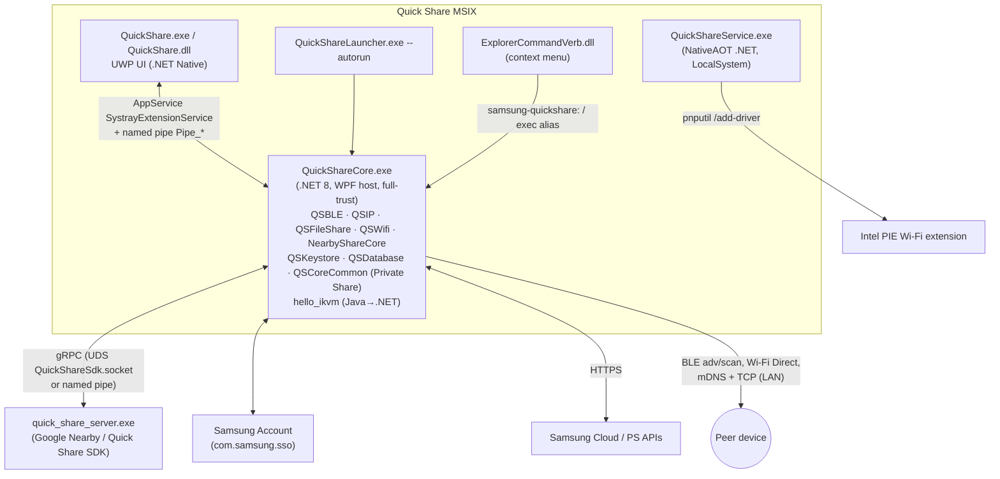

# 02 — Quick Share

## 1. Purpose

Peer-to-peer file/link/text/Wi-Fi-credential sharing between the PC and Galaxy/Android devices (and other PCs), plus:

- **Private Share** — expiring, revocable, traceable shares backed by a permissioned blockchain ledger and Samsung Cloud relay.
- **Link Sharing** — large-file upload to Samsung cloud storage with a link (background upload/download completion tasks).
- **Google Quick Share (Nearby Share) interop** — delegated to Google's `quick_share_server.exe` via gRPC.
- **Contact/"buddy" discovery** — Samsung account contacts and Family group devices.
- Explorer "Share with Quick Share" context menu and Windows Share target.

## 2. Packaging & deployment

| Item | Value |
|---|---|
| Package | `SAMSUNGELECTRONICSCoLtd.SamsungQuickShare_2.3.22.0_x64__wyx1vj98g3asy` (1,356 files, 489 MB) |
| Publisher ID | `wyx1vj98g3asy` (second Samsung publisher, shared with Camera Share and Continuity) |
| Dependencies | UWP 10.0.19041, WinUI 2.8, .NET Native 2.2, VCLibs, Store Engagement |
| Capabilities | `runFullTrust`, `unvirtualizedResources`, `localSystemServices`, `packagedServices`, `confirmAppClose`, `broadFileSystemAccess`, `userSystemId`, `cellularDeviceControl/Identity`, `internetClient(Server)`, `enterpriseAuthentication`, `sharedUserCertificates`, `privateNetworkClientServer`, `picturesLibrary`, `userAccountInformation`, `bluetooth`, `radios`, `proximity`, `wiFiControl` |
| Firewall rules | `QuickShareCore\QuickShareCore.exe`: TCP + UDP, in + out, all profiles (manifest `desktop2:FirewallRules`) |
| Service | `SamsungQuickShareService` → `QuickShareService\QuickShareService.exe`, auto, LocalSystem |
| Startup task | `QuickShareAppsStandbyId` → `QuickShareLauncher\QuickShareLauncher.exe --autorun` (enabled) |
| Full-trust process | `QuickShareCore\QuickShareCore.exe` with parameter groups `/START_ON_ACTIVATED`, `/START_ON_LAUNCHED`, `/START_ON_SUSPENDING`, `/START_ON_APP_SERVICE_FAILURE` |
| Exec alias | `QuickShareCore.exe` |
| Protocols | `quickshare:` (ReturnResults optional), `samsung-linksharing-add-link:`, `samsung-quickshare:` (→ QuickShareCore), `samsung.privateshare.open:`, `private-share:` |
| AppServices | `SystrayExtensionService`, `com.samsung.sso`, `com.samsung.privateShare`, `com.quickshare.linksharing.transfer`, `samsung-nearbydevices` |
| Share target | Any file type; formats `Uri`, `StorageItems` |
| Shell extension | COM surrogate `ExplorerCommandVerb.dll`, CLSID `AA19E113-013C-134C-B0A1-1AC1BCEB38FE`, verb `CContextMenuForQS` on `Directory` and `*` |
| Background tasks | `…LinkSharingService.Transfer.CompletionGroupBackgroundTask.{Upload,Download}CompletionGroupBackgroundTask` (systemEvent) — BackgroundTransfer completion groups |
| Bundled 3rd-party | Google Quick Share server (`Assets\NearbyShareServer\quick_share_server.exe`, 21 MB), Google updater bootstrap (`C:\Program Files\Samsung\GoogleQuickShareSDK\googleupdatesetup.exe`), Intel PIE driver package (`QuickShareService\PieExtension\`), `pnputil.exe` copy |

## 3. Architecture

### 3.1 Process roles

| Process | Tech | Responsibilities (observed) |
|---|---|---|
| `QuickShare.exe` + `QuickShare.dll` | UWP, .NET Native (no CLI metadata; 7.4 MB string table) | Main window, device list, history, settings, Private Share pages, toasts; hosts AppServices and background tasks; `MetroLog`, Lottie, Win2D, WebView2. |
| `QuickShareCore.exe` (`QuickShareCore.dll` 2.1.0.0, .NET 8) | WPF desktop bridge | All radios and transfer protocols, tray icon (`SystemTrayController`), theme watching, Private Share blockchain node, file-URI preparation (Gallery NDE originals, HDR info, MediaInfo). REA `ev_d05160b8ce32aa69b75ae7b9e0e91b2df34e7bfbb57163e4fadd2a973131043e`. |
| `QuickShareLauncher.exe` | native | Startup-task stub; starts Core in standby. |
| `QuickShareService.exe` | .NET NativeAOT (16 MB) | `AgentWatcher` (OOBE gate, first-launch), `DriverInstallerManager`/`DriverManager`/`PnpUtilRunner` (Intel PIE driver install/upgrade), `BandManager`/`QCSupportedBandChecker` (Wi-Fi band capabilities), `NwRegistryCleanManager`, `CrashDumpManager`, session/power event handlers. |
| `quick_share_server.exe` | Google C++ (Nearby Connections, gRPC, protobuf) | Google Quick Share protocol stack (BLE, Wi-Fi LAN, Wi-Fi Direct/hotspot, WebRTC, QR). |

## 4. Component engineering (QuickShareCore modules)

| Assembly | Role | Key types |
|---|---|---|
| `QSBLE.dll` | BLE discovery, advertising, GATT auth, privacy commands | `BleManager`, `BleDiscoveryAgent`, `BleAuthManager`/`BleAuthHelper` (`Authentication.Sender/Receiver`), `AdvertisingDataSpecConst`, `ResponseDataSpecConst`, `PinAcceptTimer`, `VisibilityChangingTimer`, `P2PFrequencyHandler`, protobuf `Command`/`Container`/`ChannelProtocol` (`Request`, `Response`, `Token`, `LanExtras`, `P2pExtras`, `Certificate`, `PrivacyRequestV1`, `PrivacySyncLedger`). REA `ev_764806fe…b18030` |
| `QSIP.dll` | LAN transport | `MdnsManager`/`QSMdnsAgent` (Makaretu.Dns.Multicast), `IPManager`, TCP `SenderService`/`TCPSocketClient`, `ReceiverService`/`TCPSocketServer`, `DataReader/Writer`, `LanAvailabilityChecker` |
| `QuickShareCore.dll` → `Connectivity.WifiDirect` | Wi-Fi Direct | `WFDManager` (`StartAsAdvertiser`, `StartAsConnector`, fixed-channel scan), `WifiDirAdvertiser` (`WiFiDirectConnectionListener`, `HandleConnectionRequestWithoutPairAsync`), `WifiDirConnector` (`DeviceWatcher`, `ConnectWithoutPairAsync`), `WifiDirCommon` (`GetGOIntentValue`, `CheckWhoIsGroupOwner`) |
| `QSFileShare.dll` | File transfer protocol stacks | `fileshare.fastshare.session` (+ `message.action_message`, `status_message`, `network`), `fileshare.ftcp` (+listeners), `fileshare.fileshare_device.ftd`, `extend.transcoding`, `aware.sender` (Samsung "Aware" extended service `com.samsung.android.aware.service.extend`), full UPnP stack (`upnp.discovery`, `avtransport`, `control.cd`, `httpparser`) for DLNA-style media push. REA `ev_d0eaff53…bcdac1` |
| `QSWifi.Common`, `QSWifiProfileShare`, `QSNatives` | WLAN helpers, Wi-Fi credential sharing, `wlanapi`/`bthprops` P/Invokes (`WlanSetProfile`, `BluetoothEnableDiscovery`, `DeviceIoControl`) | REA `ev_3470b1a4…091d05` |
| `NearbyShareCore.dll` | Google Quick Share client | `GrpcConnectionManager`, `NamedPipesConnectionFactory`, `UnixDomainSocketConnectionFactory`, `NSSenderService`, `NSReceiverService`, `NSServiceInfoProvider`; protobuf service `google.quick_share_sdk.v1.QuickShare` (GetVersion, Get/Set Visibility, Set/GetDeviceName, Set/GetDownloadsDirectory, GetCurrentAccount, SignIn, Logout, RegisterObserver, Register{Send,Receive}Surface, Get/SetGoogleDataCollectionEnabled). REA `ev_250f9a2e…a1657c` |
| `QSKeystore.dll` | Samsung cloud identity & certificates | `SCPamApiWrapper` (register/renew/deregister device, fetch product + images), `SCPdmApiWrapper` (Generate/Retrieve/UpdateCertificate), `BuddyInfoWrapper` (contact discovery: service number, buddy list, images), `SCFamilyAccountWrapper` (family group, device registration, push callbacks), `SaClientService` (Samsung Account token via AppService) |
| `QSDatabase.dll` | SQLite (`DBCloudContext`) | DAOs: SamsungAccount, IdentityAccessManagement (registration, push token, user token), PersonalDataManagement (certificates, device info, user AES key), BuddyDataManagement, FamilyAccount, OperationalDataManagement (device images); `DBReaderWriterLocker` |
| `QSCoreCommon.dll` | Private Share service layer | `ShareService`, `ChannelGeneratorService`, `InvitationManagementService`, `InviteMemberResponderService`, `ImportGenesisBlockPushHandler`, `SecurityService` (asym keys), `SymmetricService`, `KeyWrapper`, `DownloadService`, `FileBlockchainNotificationService` (Revoke, ChangeExpireTime), notification builders |
| `hello_ikvm_1.0.0.8.dll` (+ `IKVM.Runtime`, `IKVM.OpenJDK.*`) | Java/Kotlin Android library cross-compiled to .NET with IKVM | `com.samsung.android.privacy.internal.blockchain.*`, Kotlin stdlib, kotlinx.serialization, SpongyCastle (TLS, CMS, OpenPGP, XMSS) — the Android Private Share ledger engine reused verbatim |
| `BlockchainApisWin.dll` / `BlockchainApisProjection.dll`, `WPF-blcokchain-dll` | WinRT/WPF bridge to the ledger | `DesktopBridge.Blockchain.{BlockchainImpl, BlockchainService, MessageHandler, ListenerPc, StoragePC, Sign, VerifierPC, Push}` |
| `PhoneNumbers.dll` | libphonenumber port (contact hashing / MSISDN) | |
| `MediaInfo.dll` | media metadata for HDR/transcode decisions | |

### 4.1 Transport selection (inferred from types and strings)

1. **Discovery**: BLE advertising/scanning (custom service data; GATT descriptors/characteristics with Samsung 128-bit UUIDs `0000aa01-0000-1000-9000-00609f1bfd7e`, `0000aa2b-…`, and 16-bit `0xFD7E`; also standard `0x2902` CCCD and `0x2A2B`), plus mDNS on LAN (`ParseTxtRecord`, `ParseLanFeature`). Visibility modes are governed by `VisibilityChangingTimer` and contact/everyone settings.
2. **Authentication/session**: BLE GATT auth exchange (`BleAuthManager`, `AuthPacketConst`), PIN acceptance (`PinAcceptTimer`, `PinPopupDeclineDelegate`), device certificates retrieved from Samsung PDM (`SCPRetrieveCertificate`) for contact-only visibility.
3. **Data path**: prefer LAN (`LanAvailabilityChecker`) when both peers share a subnet; otherwise Wi-Fi Direct (Quick Share acts as GO or client, fixed channel per `P2PFrequencyHandler`/band detector) — TCP sockets over the chosen link (`FTCP`/FastShare session).
4. **Google peers**: hand off to `quick_share_server.exe` via gRPC.

## 5. IPC & integration contracts

| Channel | Detail |
|---|---|
| UWP ↔ Core | AppService `SystrayExtensionService` (DesktopBridge pattern) + `NamedPipeServerConnectionCallback` pipes prefixed `Pipe_`. Core is (re)launched via `FullTrustProcessLauncher` parameter groups when the UWP is activated/launched/suspending or the AppService fails. |
| Core ↔ Google server | gRPC over Unix domain socket `Google\Nearby\QuickShare\QuickShareSdk.socket` (path under user AppData — inferred) or named pipe, `http://localhost` authority, retry loop `RetryConnectionEstablishment`. |
| Core ↔ Samsung Account | AppService to `SAMSUNGELECTRONICSCO.LTD.SamsungAccount_3c1yjt4zspk6g` / `com.samsung.sso` (`SAClientAppServiceHandler`). |
| Core ↔ Gallery | `com.samsung.gallery.galleryprovider.1.1` AppService (`CallAppVersionAsync`, `CallAppIsNDEAsync`, `GetNdeOriginalPathAsync`) to send original (non-destructive-edit) images. |
| Core ↔ Continuity | package family `SAMSUNGELECTRONICSCoLtd.SamsungContinuityService_wyx1vj98g3asy` referenced; AppService `samsung-nearbydevices` exposes nearby-device state to other apps. |
| Settings ↔ Quick Share | Settings Wi-Fi share hands credentials to Quick Share; `IsInstalledQuickShareApp`. |
| Registry | `QuickShareIsLaunchedOnce`, `QuickShareIsNoIntelDriverChecked` (service log). |

## 6. Data & state

- Package LocalState: `%LOCALAPPDATA%\Packages\SAMSUNGELECTRONICSCoLtd.SamsungQuickShare_wyx1vj98g3asy\LocalState\` (SQLite DBs, Private Share ledger storage `StoragePC`, logs).
- Service logs: `C:\ProgramData\Samsung\QuickShare\ServiceLogs\QuickShareServiceLog*.log` (NLog, source file+line in each record).
- Cloud DB content (QSDatabase): SA login data, SC registration (push token, user token), PDM certificate, device lists, **user AES key**, family members/devices, buddy list/images.

## 7. Network endpoints (observed strings)

| Endpoint | Use |
|---|---|
| `https://api.samsungcloud.com`, `https://stg-api.samsungcloud.com` | PAM/PDM/IAM, Private Share, Link Sharing |
| `https://stg-play.samsungcloud.com` | staging |
| `https://api.samsungps.com/ps` | Samsung push service (inferred: "ps") |
| `https://dl.google.com/tag/s/appguid={6DF554AC-E76F-4C51-8A4B-79668743421C}…appname=Quick Share Server&needsadmin=true…/googleupdatesetup.exe` (prod, `PartnerDev`, `PartnerQA` variants) | Installs/updates Google's Quick Share Server via Google Update |
| Google OAuth client id `991816988175-…apps.googleusercontent.com` | Google account sign-in for Nearby interop (public client identifier) |

## 8. UI/UX design

- UWP (WinUI 2.8) main app with Lottie animations, WebView2 (help/legal), tray presence through Core's WPF `SystemTrayController` (tray-icon overflow cleanup via `FindWindowEx`/`SendMessage` on `Shell_TrayWnd`).
- Entry points: Start menu, tray, Explorer context menu, Windows share sheet, `quickshare:` URI, Settings (Connected devices) and Galaxy Connect.
- Toast-driven receive flow: incoming request toast → accept/decline → progress toast → "open folder" (`SHOpenFolderAndSelectItems`).
- Private Share flows: notification builders cover uploading/sending/complete/waiting, channel creation/denial, connection failures, expiry change, revoke, critical-update prompts (`ToastNotificationHandler` routes to Channels / Sent / Received pages).

## 9. Key flows

**Send to a nearby Galaxy device**
1. User selects files (share target / context menu / app) → Core `FileUriContainerManager.PrepareFileUriContainer*`.
2. BLE scan + mDNS → device list (contacts first via buddy list/certificates).
3. Select device → BLE auth/PIN → negotiate LAN or Wi-Fi Direct (`WFDManager.StartAsConnector`).
4. TCP session (FastShare/FTCP) streams files; progress → UWP via AppService → toasts.

**Receive** mirrors with `WifiDirAdvertiser` / `ReceiverService`, accept popup timer, write to download directory.

**First boot / service**
1. `QuickShareService` waits for OOBE (`IsOOBEComplete` → `IMAGE_STATE_COMPLETE`), checks `QuickShareIsLaunchedOnce`.
2. `pnputil /enum-drivers` → find `pieextension.inf` version → if older than packaged (e.g. installed 23.1060.5.7 vs packaged 23.1060.5.3 logic) `pnputil /add-driver PieComponent.INF` (log shows an install attempt returning "Installation error!").
3. On `SessionLogoff`, `NwRegistryCleanUp` enumerates the NetworkList policy key (`DefaultMediaCost`, `NewNetworks`, `Nla`, `Permissions`, `Policies`, `Profiles`, `Signatures`, `FirewallSync`) to remove Wi-Fi Direct network profiles created by sessions (inferred purpose).

## 10. Security & privacy observations

1. Broad capability set incl. `broadFileSystemAccess`, `cellularDeviceIdentity`, `userAccountInformation`, `enterpriseAuthentication`, `sharedUserCertificates`.
2. Inbound TCP/UDP allowed on all firewall profiles for `QuickShareCore.exe` — includes Public networks.
3. SYSTEM service installs third-party (Intel) driver packages using its own bundled `pnputil.exe` copy.
4. Logoff-time deletion under the NetworkList registry (S-7) — risk of removing unrelated profiles if filtering is loose (not verified).
5. Google Quick Share Server is downloaded at runtime from `dl.google.com` with `needsadmin=true` (machine-wide install by Google Update).
6. Private Share stores asymmetric/symmetric key material and an AES user key in local SQLite; protection mechanism (DPAPI vs plaintext) not determined.
7. Logs use `LogSecure`-style masking in MCF libraries; Quick Share service logs contain full package paths and registry keys but no transfer contents (observed sample).

## 11. Evidence

- REA: QuickShareCore `ev_d05160b8…043e`, QSBLE `ev_764806fe…030`, QSFileShare `ev_d0eaff53…a1`, NearbyShareCore `ev_250f9a2e…57c`, QSNatives `ev_3470b1a4…05` (`recon/rea_evidence_index.txt`).
- SHA-256: `QuickShareService.exe ce7dcd3e…19ac`, `quick_share_server.exe 1750834b…3005`, `QuickShare.dll 28101ac5…87b9`.
- Dumps: `recon/md/SamsungQuickShare/*.txt`, `recon/native/QuickShare*.txt`, `quick_share_server.exe.txt`; manifest `recon/manifest_SAMSUNGELECTRONICSCoLtd.SamsungQuickShare.txt`; log `C:\ProgramData\Samsung\QuickShare\ServiceLogs`.

## 12. Unknowns

- Exact BLE advertisement byte layout (`AdvertisingDataSpecConst`) and FastShare wire format — need IL decompilation of `QSBLE`/`QSFileShare`.
- UWP page structure (no metadata in .NET Native image).
- Whether the PIE driver is required for concurrent STA + Wi-Fi Direct (strongly suggested by name and Continuity sharing the same component; inferred).
