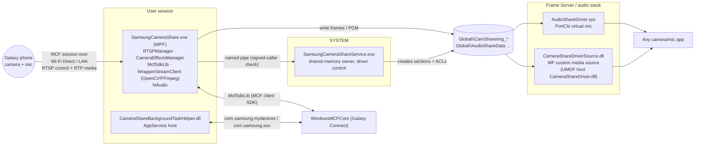

# 03 — Camera Share

## 1. Purpose

Use a Galaxy phone's camera (and microphone) as a Windows webcam/mic for any app (Teams, Zoom, Camera app). The phone streams video/audio over a Samsung MCF (Multi-Control Framework) peer link; the PC exposes it through a **virtual camera** (Media Foundation custom media source in a UMDF driver) and a **virtual audio endpoint** (PortCls kernel driver). Also supports phone-side camera effects (blur, face effects, camera switch), Family device sharing, and status (phone battery).

## 2. Packaging & deployment

| Item | Value |
|---|---|
| Package | `SAMSUNGELECTRONICSCoLtd.16297BCCB59BC_2.3.12.0_x64__wyx1vj98g3asy` (display name "Camera Share", 403 files, 292 MB) |
| Dependencies | UWP/Desktop 10.0.22621 (Windows 11 22H2+ — required for MF virtual camera / Frame Server custom sources), VCLibs, .NET Native 2.2 |
| Capabilities | `internetClient`, `sharedUserCertificates`, `runFullTrust`, `localSystemServices`, `packagedServices`, `unvirtualizedResources`, `bluetooth`, `proximity`, `radios`, `wiFiControl` |
| App | `CameraShare\SamsungCameraShare.exe` (WPF, .NET Framework 4.8), exec alias `SamsungCameraShare.exe`, protocol `camerashare:` |
| Service | `SamsungCameraShareService` → `CameraShareService\SamsungCameraShareService.exe` (.NET Fx 4.8), auto, LocalSystem |
| Startup task | `CameraShareStandbyId` → `CameraShareStartupLauncher\CameraShareStartupLauncher.exe /AutoStart` |
| Full-trust process | `SamsungCameraShare.exe /StartedbyappService` |
| AppServices | `com.samsung.sso`, `com.samsung.mydevices` → `CameraShareBackgroundTasks.AppServiceComponent` in `CameraShareBackgroundTaskHelper.dll` (also `NearbyDeviceAppServicehandler`, `SASSOAppServiceHandler`) |
| Toast COM activator | CLSID `250C5597-BA73-40DF-B2CF-DD644F044834` → `SamsungCameraShare.exe -ToastActivated` |
| Firewall | `SamsungCameraShare.exe` TCP/UDP in+out, all profiles |
| Drivers (bundled) | `CameraShare\Drivers\Camera\x64\CameraShareDriver.dll` (UMDF, `FxDriverEntryUm`) + `CameraShareDriverSource.dll` (MF media source COM server); `CameraShare\Drivers\Audio\x64\AudioShareDriver.sys` (PortCls + KMDF); `CameraShareDriversInstaller.exe`, `devcon.exe` |

Version history visible in logs: service 2.0.6.0 (2026-02, older `C:\ProgramData\Samsung\CameraSharing\` log dir) → 2.3.12.0 (current, `…\CameraShare\`).

## 3. Architecture

### 3.1 Why a SYSTEM service

`Global\` section objects can only be created by a process with `SeCreateGlobalPrivilege`; the camera media source runs inside the Windows Camera Frame Server (a service session) and the audio driver in kernel. The service creates the sections, applies explicit security (`SetSecurityInfo` on the mapping handles), and the user-session app opens and writes them. The service also enables/disables the drivers and toggles the device friendly name.

## 4. Component engineering

### 4.1 `SamsungCameraShareService.exe` (REA `ev_27092aca55a9ab6ebbceaa422b0a8d52a553ed22f640aa98ac775ce125fd7976`)

| Type | Responsibility |
|---|---|
| `CameraShareService : ServiceBase` | `OnStart/OnStop/OnCustomCommand` (custom command restarts the pipe server) |
| `IPC.ServiceNamedPipeServer` | Pipe server; `GetPipeSecurity`; `GetNamedPipeClientProcID` → `SamsungProcessValidationHelper.IsValidSamsungApp` (`VerifySamsungSign`, `HasCodeSigningEku`, `VerifyTrustChain`) |
| `IPC.ServiceNamedPipeManager` | Message dispatch, driver message queue (`EnqueueDriverMessage`, `ProcessDriverMessageQueue`), user name lookup |
| `Managers.CameraSharedMemoryManager` | Creates `Global\CamShareImg_*`, `CamShareImgNum`, `CamShareCamType`, `CamShareResolutionType`, `CamShareStreamingState`; `UpdateHeightWidthInfo` |
| `Managers.AudioSharedMemoryManager` | Creates `Global\AudioShareData`, `AudioBufferStartIndex`, `AudioStreamingState`, `AudioDriverState` |
| `Managers.CameraDriverManager` | `EnableDriver`, `DisableDriverAsync`, `ChangeDriverName` |
| `Managers.AudioDriverManager` | `IsAudioDriverInstalled/Enabled`, `Enable/DisableAudioDriver` |
| `Managers.RegistryManager` | `ChangeFriendlyNameFromReg` / `ChangeFriendlyNameOfDeviceClass`, streaming state in `.DEFAULT\Software\Samsung\CameraShare`, path ACLs, registry change watcher |
| `Utilities.Logger` | NLog-style log + `SetProcessMitigationPolicy` (redirection-trust policy) |
| `StringExtension.Obfuscate` | log masking |

### 4.2 `SamsungCameraShare.exe` (REA `ev_48eb4c67df180ab4ef54e2079f73248b93e756dd91ee218e03d91df1f41377c2`)

Namespaces: `ViewModels` (Main, DeviceList, CameraEffect, About/HowTo/OSS, Splash, Shell, Tips dialog), `Managers`, `Services` (Navigation, Page, Dispatcher, ApplicationHost (`IHostedService`), NetworkInterfaceService, NativeServices, SingleInstanceService), `SamsungAccount` (Request/Response/AppCommunication), `NamedPipe`, `CSToastNotification`, `Helpers.MCFCoreAppServiceHelper`, `SamsungAnalytics`, `TestMode`.

| Manager | Function |
|---|---|
| `OnboardingManager` | `SetupSamsungDrivers`, `PrepareComponentsAsync`, defaults |
| `CameraDriverManager` | Install/uninstall/upgrade CS driver (`IsCSDriverUpdateRequired`, `InstallCSDriver`, registry watcher on driver state) |
| `AudioDriverManager` | Install AS driver from installer or INF, legacy hardware status, version compare |
| `RTSPManager` | `SendConnectRequest`, `SendRequestToConfigureMediaInfo`, `SendRequestToStartRtpServer`, `StartReceivingStream`, play/pause audio & video, resolution (720p/1080p) |
| `CameraSharedMemoryManager` | `WriteBitmapImageByChunk`, `WriteImageNumber`, `WriteResolutionType`, `WriteCameraType`, `CopyPauseFrameImage` |
| `AudioSharedMemoryManager` | `WriteMonoDataWithPointer`, `WriteStereoDataWithPointer`, `WriteStartIndex`, `WriteStreamingState` (8/44.1/48 kHz) |
| `CameraEffectsManager` | effect list / apply / reset requests to phone; phone battery status info |
| `NearbyDevicesManager` | device state messages to MCF (`SendNotConnectableMessageAsync`) |
| `FamilyDeviceSharingManager` | registry-monitored Family MDE settings; camera access request to family device |
| `CameraShareServiceManager` | start/restart service if stopped |
| `PowerRegisterManager` | suspend/resume handling |
| `ThemeWatcher`, `RegistryManager` | light/dark/high-contrast (WMI `RegistryValueChangeEvent`) |
| Controllers | `BluetoothController`, `WiFiController` (turn radios on, `wlanapi` interface state) |

Streaming libs: `WrapperStreamClient.dll` (3.2 MB, 1,344 types) / `WrapperStreamServer.dll` — RTSP/RTP stack (types compiled from another language/codegen; *inferred*), `DotNetty.Common`, OpenCvSharp + `opencv_videoio_ffmpeg4100_64.dll` (decode), NAudio (WASAPI/WinMM), `InTheHand.Net.Bluetooth`.

MCF SDK: `McfSdkLib.dll` 7.3.0.0 + `McfSdkLibFramework.dll` (REA `ev_809cf4b4…40e73`) — connection life-cycle (`RequestConnect`, `OnResponseConnectionCompleted`, session key exchange "socket connected. Waiting for SessionKey"), version gating against MCF Core versions (1.3.6 … 1.20.2, 4.6.1202), and **QoS**: builds PowerShell `New-NetQosPolicy -Name … -IPProtocol … -IPSrcPortMatchCondition … -DSCPAction …` (with `-PolicyStore ActiveStore`) to DSCP-mark media traffic.

### 4.3 Drivers

| Driver | Observed design |
|---|---|
| `CameraShareDriver.dll` | UMDF 2 driver (`FxDriverEntryUm`, WPP tracing) whose device interface registers the custom media source `CameraShareDriverSource` |
| `CameraShareDriverSource.dll` | C++/WinRT COM in-proc server (`DllGetClassObject`) derived from the Windows **SimpleMediaSource** sample (`winrt::WindowsSample::implementation::CameraShareDriverSource`). `CameraFrameGenerator::{Initialize, CreateFrame, RGB24ToNV12Frame, _CreateRGB24Frame}` reads RGB24 frames from `Global\CamShareImg_<n>` and converts to NV12; sensor profiles via `MFCreateSensorProfile*`; sample allocator `MFCreateVideoSampleAllocatorEx` |
| `AudioShareDriver.sys` | PortCls miniport (`PcNewMiniport`, `PcRegisterSubdevice`, physical connections) + KMDF binding, modelled on SYSVAD (`DriverData\Audio_Samples\AudioShare\STREAM`); reads `\BaseNamedObjects\AudioShareData`, `AudioBufferStartIndex`, `AudioStreamingState`, `AudioDriverState` sections from kernel |

## 5. IPC & data contracts

| Object | Producer → Consumer | Content |
|---|---|---|
| `Global\CamShareImg_<i>` | App → MF source | RGB24 frame chunks (ring indexed by `CamShareImgNum`) |
| `Global\CamShareResolutionType`, `CamShareCamType`, `CamShareStreamingState` | App/Service → MF source | resolution enum, front/rear, streaming flag |
| `Global\AudioShareData` + `AudioBufferStartIndex` | App → audio driver | PCM ring buffer + write index |
| `Global\AudioStreamingState`, `AudioDriverState` | App/Service ↔ driver | flags |
| Named pipe (service) | App ↔ Service | JSON-ish messages: driver enable/disable, friendly-name change, audio `AudioDriverInstalled/UnInstalled` status |
| Named pipe (single instance) | 2nd instance → 1st | command-line forwarding (`SingleInstanceHelper.GetPipeName`, hash of running process) |
| AppService `com.samsung.mydevices` | MCF/Continuity → Camera Share | nearby-device events; launches app with `/StartedbyappService` |
| AppService `com.samsung.sso` | Account → Camera Share | sign-in state |
| Registry | `.DEFAULT\Software\Samsung\CameraShare` (streaming state), device class FriendlyName | |

## 6. UI/UX design

- WPF with `Samsung.OneUI.WPF` + MaterialDesignThemes, SharpVectors SVG icons, animated GIF illustrations, theme-reactive icons (`OnWindowsThemeChangedForIcons`).
- Pages: Splash → Main (toggle on/off, BT/Wi-Fi prerequisite banners with "Turn on" buttons) → device list user control (paired device memory in local settings, P2P disconnect timers) → Camera effect window (blur slider, face effects, switch camera, view type) → How to use, About (version tap → password-protected TestMode, store update check), OSS licenses; Tips dialog ("Can't find phone", "Sign in to Samsung Account", "Turn on BT/Wi-Fi").
- Analytics events (`SamsungAnalytics.PageIDs/PageEvents/ToggleSwitch/SwitchCameraView/InstallSA`).

## 7. Key flows

**Start streaming**
1. User picks Camera Share as webcam in a client app or toggles on in UI → app checks service (`IsCameraShareServiceStopped` → start).
2. App discovers phone via MCF (`McfSdkLib`) → MCF Core establishes BT/Wi-Fi Direct/LAN path and session key.
3. `RTSPManager`: connect → configure media info → phone starts RTP server → `StartReceivingStream` (FFmpeg/OpenCV decode).
4. Frames written to `Global\CamShareImg_*`; audio PCM to `Global\AudioShareData`; streaming state flags set.
5. Frame Server loads `CameraShareDriverSource`, which converts RGB24→NV12 per sample request; audio driver renders capture stream.
6. QoS policy marks media ports with DSCP.

**Driver onboarding**: first run → `OnboardingManager.SetupSamsungDrivers` → `CameraShareDriversInstaller.exe`/`devcon.exe` (elevated) installs UMDF camera + PortCls audio drivers; versions compared each launch.

## 8. Security & privacy observations

1. Shared sections are global objects readable by the Frame Server/kernel; the service applies custom DACLs (`SetSecurityInfoByHandle`) — exact SDDL not recovered (unknown). Over-permissive ACLs would let other local users read camera frames/mic audio.
2. Pipe callers are validated by Authenticode chain + code-signing EKU + Samsung signer (stronger than name-only check used elsewhere).
3. App can create system QoS policies through PowerShell (requires elevation; observed string, invocation context not traced).
4. Hidden TestMode behind a version-number tap + password (`CheckTestModePassword`, hashed compare).
5. Logs include region/locale and obfuscated identifiers.

## 9. Evidence

- REA: App `ev_48eb4c67…77c2`, Service `ev_27092aca…7fd`, McfSdkLib `ev_809cf4b4…0e73` (native-boundary `ev_6227656a…0b70`).
- SHA-256: `CameraShareDriverSource.dll d2419a0a…ece2`, `AudioShareDriver.sys 2f5b6837…99b0`.
- Dumps: `recon/md/16297BCCB59BC/*.txt`, `recon/native/CameraShare*.txt`, `AudioShareDriver.sys.txt`; logs `C:\ProgramData\Samsung\CameraShare\Logs`, `…\CameraSharing\Logs`.

## 10. Unknowns

- RTSP/RTP payload format (H.264/HEVC) and port numbers — `WrapperStreamClient` not decompiled.
- Pipe name of the service pipe and its SDDL.
- Shared-memory frame header layout.
