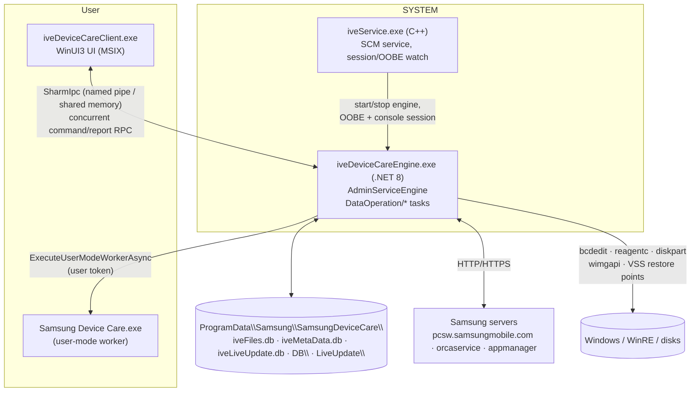

# 04 — Samsung Device Care

## 1. Purpose

All-in-one maintenance app for Galaxy Book PCs ("ive" is the internal code name):

- **Storage**: temp-file cleaning (Windows Disk Cleanup handlers), recycle bin, duplicate files, per-file-type lists, large/old files — powered by an NTFS **MFT parser** and index DB.
- **Memory** cleaning (working-set trimming).
- **Security apps** check (antivirus presence/monitoring).
- **Update** ("Live Update"): BIOS, drivers, Samsung software, patches — server-driven catalogue (absorbs functions of Samsung Update, doc 07).
- **Recovery / Backup** (formerly *Samsung Recovery*): sector backup images, disk copy, factory image restore via WinRE, restore points & app timeline.
- **Maintenance mode**: PIN/email-protected lock mode for handing the PC to a service centre.
- Privacy policy / EULA (GDPR vs non-GDPR, Korea-specific) gating.

## 2. Packaging & deployment

Hybrid: a Store-delivered UI + an MSI-installed privileged backend.

| Piece | Location | Tech | Version |
|---|---|---|---|
| UI client | MSIX `SAMSUNGELECTRONICSCO.LTD.SamsungPCCleaner_4.0.80.0_x64__3c1yjt4zspk6g` — `iveDeviceCareClient.exe` (.NET 8 apphost) | WinUI 3 (Windows App SDK) + MVVM | 4.0.80.0 |
| Service | `C:\Program Files\Samsung\SamsungDeviceCare\iveService\iveService.exe` ("Samsung Device Care Service", auto, LocalSystem) | native C++ | — |
| Admin engine | `…\iveDeviceCareEngine\iveDeviceCareEngine.exe` + `iveDeviceCareEngine.dll` | .NET 8 WPF-hosted headless app (`Application`, hidden `MainWindow`) | 4.0.80.0 |
| User-mode worker | `…\iveUserModeWorker\Samsung Device Care.exe` / `.dll` | .NET 8 | — |
| Uninstaller/cleanup | `…\iveCleaner\iveCleaner.exe` | .NET | — |
| Installer | WiX MSI (`SetupCustomAction.CA.dll`, `WixToolset.Dtf.WindowsInstaller.dll`, `CustomAction.config`); self-update packages `DeviceCareInst.exe`, `DeviceCareInst_Arm64.exe` | | |

Manifest (client): capabilities `runFullTrust`, `unvirtualizedResources`; protocols `com.samsung.devicecare:` and `gfclient:`. The package name "PCCleaner" is a legacy identity reused for Device Care.

Shared libs (both engine and worker): `iveCommunication.dll` (contracts), `SCRecovery.dll`/`SCRecoveryCLI.dll` (recovery 9.0.80.0), `SCLiveUpdate.dll`/`SCLiveUpdateCLI.dll` (4.0.52.0), `SCUtil*`, `SCStdUtil`, `SCCommunication`, `SharmIpc.dll` (IPC), `SupportSRS.dll` (native, recovery helper), `mfc140u.dll`, `Ijwhost.dll` (C++/CLI host → `*CLI.dll` are C++/CLI mixed assemblies), `Nager.Country`, SamsungAnalytics SDK.

## 3. Architecture

### 3.1 Roles

- **iveService** (`IveService::{ServiceMain, Start, Stop, Pause, Continue, Shutdown}`, `EngineManager::WaitOOBEAndActiveConsole`, `DeviecNotifyCallbackRoutine`): waits for OOBE and an active console session, starts/stops the engine, kills it with `taskkill /f /im` when needed, uses `sc.exe`; heartbeat log every 30 s (`ServiceStop exist`), monitor timeout every 2 min.
- **iveDeviceCareEngine** (`App.Application_Startup`): checks EULA/PP, starts `AdminServiceEngine : DataServiceEngine`, initialises `SCRecovery` and `SCLiveUpdate`, handles special flows (`RunDISMFactoryBackupFlow`, `RunSilentFactoryRestoreFlow`, `RecoveryOnUserMode`, `InvokeUserModeWorkerForOSLangTZ`), mitigations via `SetProcessMitigationPolicy`.
- **AdminServiceEngine**: command router with concurrency control (`HandleConsecutiveCommand`, `OnConcurrentCommandArrived`, "Another task is already running"), pushes reports to client (`sendReportToClientAsync`), knows if client is running.
- **User-mode worker** (`iveDeviceCare.App`): tasks needing the user's context — toasts, start client, save OS language/time-zone, service start/stop, delete legacy scheduled tasks.

## 4. Engine operations (`Samsung.DeviceCareEngine.DataOperation`)

All derive from `AEngineTaskOperation<TCommand,TReport>` (`OperateAsync → OnOperateCommandAsync`, logged).

| Operation | Behaviour (observed members) |
|---|---|
| `MFTOperation` | Parses NTFS MFT into a SQLite metadata DB (`BuildMFTParseQueries`, `getFilesMetaData`, `updateDeletedFiles`, `NotifyMetaDataRefreshed`); defers work while CPU busy (`CPUMonitor` via PDH, `_isSystemIdleAsync`, `_exceededDeferThreshold`). Feeds duplicates/large files/type lists. |
| `DiskCleaningOperation` | Enumerates Disk Cleanup handlers (`EnumerateHandlers`, COM `IEmptyVolumeCache(2)` with `IEmptyVolumeCacheCallBack` progress) and purges. |
| `MemoryOperation` | `CleaningMemory` (`EmptyWorkingSet`, `GlobalMemoryStatusEx`). |
| `FileAccessOperation` | Thumbnails/icons (`GenerateIconCaches`, `CreateThumbnailsFromPath`) cached to LocalAppData / ProgramData. |
| `SecurityAppsOperation` | Antivirus inventory and monitoring (`ExecuteCommand`). |
| `CheckAntivirusOperation` | timer-based check. |
| `CheckPrivacyPolicyOperation` | Latest PP info, status persisted in DB. |
| `LiveUpdateOperation` | `RefreshLUServerDataAsync`, `RefreshClientPolicy`, `GetLiveUpdateListAsync`, `GetUniqueBOM`, `InstallLiveUpdateItemsAsync` with progress/completion reports, verification (`VerifyNoVerify`), install counts, last-refresh date; timer task. |
| `RecoveryOperation` | `SectorBackupAsync`, `DiskCopyAsync`, `RequestRestoreReboot`, EULA status saved on volumes. |
| `RestorePointOperation` | System restore point enumeration/creation, app timeline (`getAllAppsResult`, `_saveDisplayIcon`). |
| `SettingOperation` | colour theme, auto mode, auto update, maintenance-mode password compare. |

Command/report vocabulary (from `iveCommunication.Commanding.Concurrent.*Report`): `CancelRecoveryTask`, `CleaningMemory`, `ClearAllTimeLineData`, `CompareMaintenanceModePassword`, `CreateNewRestorePoint`, `CreateSectorBackup`, `DeleteBackupImages`, `DeleteDiskCleaningData`, `EnableAntivirusMonitoring`, `GenerateIconCaches`, `GetAllBackupImages`, `GetAllDiskInfo`, `GetAllEventedInstalledApps`, `GetAllRestorePoints`, `GetAllVolumeInfo`, `GetAutoMode`, `GetAutoUpdate`, `GetAvailableUpdateList`, `GetColorTheme`, `GetDiskCleaningData`, `GetEULAStatus`, `GetExcludeItemList`, … (list truncated in dump).

### 4.1 Recovery subsystem (`SCRecovery.dll`, REA `ev_21c5dafe35098bb2987e5306b927ea9a05d97fe15b3ca8af601992ff7feb8ff2`)

Tool wrappers: `BCDBoot`, `BCDEdit` (`Export/Import`, `IsTestSigningOn`, `SetTestSigning`, boot-status policy), `Diskpart` (all internal disks online), `REAgentC` (`SetOSImage`, `SetREImage`, `Fix`, `Enable`), `WinRECfg`, `Wpeinit`, `WpeUtil` (reboot/shutdown in WinPE), `Cmd.ExecScript`, `Shutdown`. Native boundaries: `Wimgapi.dll` (WIM capture/apply), `SupportSRS.dll`, `Utils.dll`, `ntdll`, privilege adjust, `RegLoadKey/RegUnLoadKey` (offline hives), impersonation, GDI capture. Settings file: `\\?\Volume{…}\ProgramData\Samsung\Recovery\Settings.xml` (on the recovery-capable volume); `C:\ProgramData\Samsung\Recovery\Log` holds ~3,150 files.

### 4.2 Live Update subsystem (`SCLiveUpdate.dll`)

`SystemConfiguration` (serial from BIOS, SMBIOS version, `IsManufacturerSamsung`, integrated EULA, INI override test mode `LiveUpdate\test.ini`), `OSInformation` (SKU parsing, Win10/11 names, `WldpQueryWindowsLockdownMode` for S-mode), `PowerInformation` (battery ≥ `BatteryLimit=30` and AC checks), item model (`LiveUpdateItem` types: Software BOM, Patch, AddSW, BIOS; `InstallCommandType`, `InstallVerifyType`, `VerifyOPType`, `InstallationStage/Status`, `ExcludeUpdateItem`, ROL support, `ItemIdentity` from CIS code or BIOS version with SHA-256). Download path `C:\WINDOWS\SystemTemp\` (observed config). Effective config fields observed in log: SerialNumber, Region, OS code (`W11Y6H2PR64`), Language, ClientVersion, BIOSVersion, EnableBIOSUpdate, IsSamsungPC, TestMode, EULAAgreed, ACCheck, BatteryLimit, NeedNotification, AutoUpdate.

## 5. IPC

- **SharmIpc** (tiesky.com library): `SharmIpc` (shared-memory ring + wait handles) and `SharmNpc` (named-pipe variant; `GetPlatformPipeName`, protobuf-style framing `ToProtoBytes/FromProtoBytes`, `RemoteRequestAsync`, `AsyncAnswerOnRemoteCall`). Client ↔ engine RPC; messages are the `iveCommunication` command/report objects (JSON).
- **Engine → worker**: `iveUserWorkerCommunication.ExecuteUserModeWorkerAsync / ExecuteUserModeWorkerByAdminAsync` (spawns `Samsung Device Care.exe` in user session with message type `UserWorkerMessageType`).
- **Service → engine**: process lifecycle only.
- Protocol activation `com.samsung.devicecare:` / `gfclient:` for deep links from toasts/other apps.

## 6. Data & state

`C:\ProgramData\Samsung\SamsungDeviceCare\`: `iveFiles.db` (MFT index), `iveMetaData.db` (restore points, apps, settings), `iveLiveUpdate.db`, `DB\`, `LiveUpdate\` (downloads, `test.ini`), `Applications\<uninstall-key>\<DisplayName>.png` (icon cache per installed app), `fil.dat`, `lastrefresh.dat`, `userconfig.json`, `logs\logYYYYMMDD.txt`, `logs\svc\iveService.N.log`.

## 7. Network endpoints

| Endpoint | Use |
|---|---|
| `https://pcsw.samsungmobile.com/DeviceCare/` | Device Care server base |
| `https://orcaservice.samsungmobile.com:10443` + `/filedownloader.aspx?type=IMG&filename={0}` | catalogue / image downloads |
| `http://orcaservice.samsungmobile.com/filedownloader.aspx?type=IMG&filename=`, `http://orcaservice.samsungmobile.com/monitor.html` | plain-HTTP variants |
| `http://appmanager.samsungmobile.com/BIOSUpdateItem/` | BIOS update items (plain HTTP) |

## 8. UI/UX design

WinUI 3 navigation shell (`MainPage` pane with `PaneButtonWidthConverter`), menu items `ACareMenuItem` / `StoreAppMenuItem` (links to other Samsung Store apps).

| Area | Pages |
|---|---|
| Home | `HomeRootPage`, `PrivacyPolicyRootPage` |
| Storage | `StorageRootPage`, `TempFileCleaningPage`, `RecycleBinCleaningPage`, `DuplicatesCleaningPage`, `EachFileTypeListPage`, `SecurityAppPage` (custom `StackedPercentageBar`) |
| Update | `UpdateRootPage` |
| Recovery | `RecoveryRootPage`, `RecoveryBackupPage`, `RecoveryBackupWorkingPage`, `RecoveryBackupManagementPage`, `RecoveryDiskCopyPage` (current vs factory disk copy VMs), `EndUserLicenseAgreementPage`, `RecoveryFactoryRestorePage` |
| Backup | `BackupRootPage` with timeline (`TimeLineRangeGenerator`, `TimeLineViewType`) |
| Maintenance | `MaintenanceRootPage`, enable flow `GuidePage → PrivacyPage → (GDPR / NonGDPRGlobal / NonGDPRKor) → EnterEmailPage → EnterPINPage → FinalChecklistPage`; disable flow `NoticeEnabledPage → EnterPINUnlockPage → RebootOnUnlockPage` |
| Settings | `SettingRootPage` (theme, auto mode, auto update) |
| Misc | `RefreshPage` |

36 value converters and template selectors reflect a data-heavy list UI; narration converters (`CleanupHandlerDataNarrationConverter`) for accessibility.

## 9. Key flows

**Engine startup**: service → engine `Application_Startup` → version banner → LiveUpdate config load → EULA/PP check (reads Recovery `Settings.xml`) → `AdminServiceEngine` → timers (LiveUpdate, antivirus, PP) → MFT indexing when idle.

**Clean temp files**: UI `GetDiskCleaningData` → engine enumerates handlers + MFT data → report → user selects → `DeleteDiskCleaningData` → purge progress callbacks → report.

**Factory restore**: UI → `RecoveryFactoryRestoreViewModel` → engine `RecoveryOperation` → configure WinRE (`reagentc`, `bcdedit`) → `RegisterRebootTaskAsync` → reboot into WinPE → WIM apply (`wimgapi`) → silent restore flow on next boot (`RunSilentFactoryRestoreFlow`).

## 10. Security & privacy observations

1. Engine runs as SYSTEM and exposes destructive operations (disk copy, sector backup, factory restore, BCD edits incl. `SetTestSigning`) to a client over IPC; the authorization model on the SharmIpc channel was not recovered (unknown) — critical to verify.
2. Device serial number, region, OS SKU written in clear text to `C:\ProgramData\Samsung\SamsungDeviceCare\logs\log*.txt` (observed).
3. Installed-application inventory + icons cached in ProgramData (S-9).
4. Plain-HTTP download endpoints (S-8); installer verification via `ServiceEngineUtil.hasValidDigitalSign` and `VerifyNoVerify` exists but end-to-end enforcement not traced.
5. Maintenance-mode PIN compared in engine (`CompareMaintenanceModePassword`); storage format unknown.

## 11. Evidence

- REA: client `ev_c6fb93cb…dbc36`, engine `ev_2d66570b…061d`, iveCommunication `ev_cc5a9335…70c5d1`, SCRecovery `ev_21c5dafe…eb8ff2`.
- SHA-256: `iveService.exe 1b5b9efc…5a90`, `iveDeviceCareEngine.exe e194122a…43e7`.
- Dumps: `recon/md/SamsungPCCleaner/*`, `recon/md/Samsung/{iveDeviceCareEngine,iveCommunication,SCRecovery,SCLiveUpdate,SCUtil,SharmIpc,…}.dll.txt`, `recon/native/iveService.exe.txt`; logs under `C:\ProgramData\Samsung\SamsungDeviceCare\logs`.

## 12. Unknowns

- SharmIpc channel names and access control.
- Server API schema for Live Update catalogue (requests built in `SCLiveUpdate`, not decompiled).
- Maintenance-mode lock mechanism (account/credential provider vs. policy).
