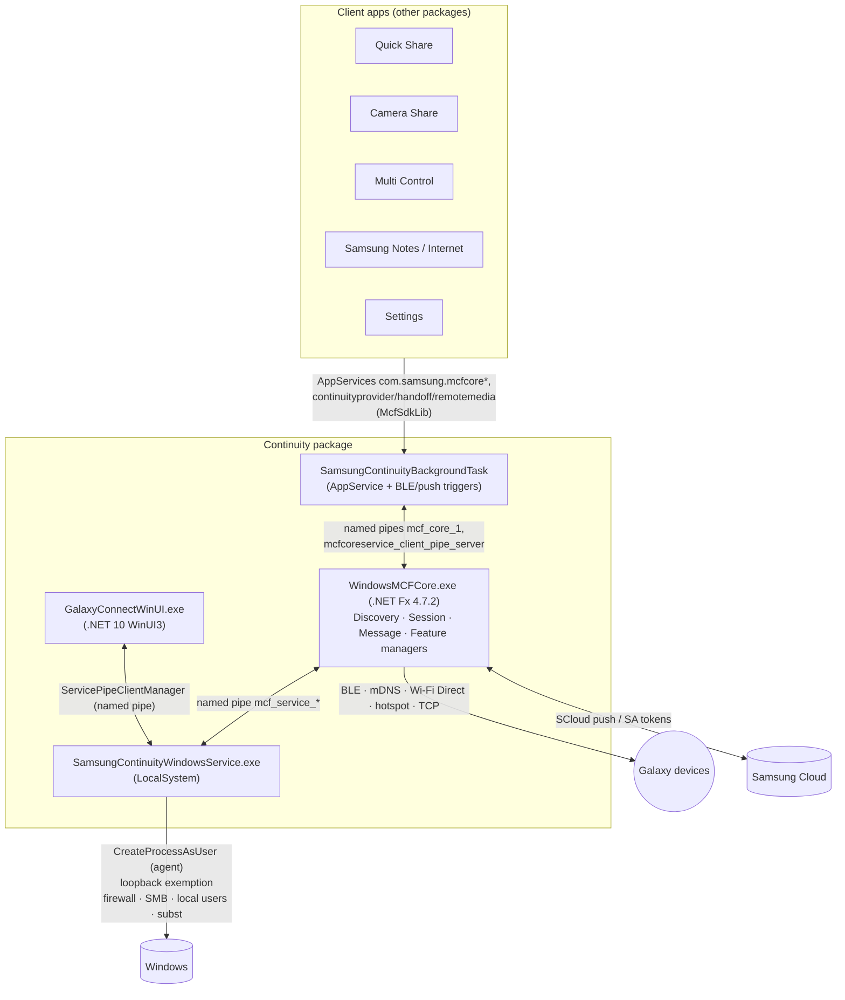

# 05 — Galaxy Connect / Samsung Continuity Service (MCF)

## 1. Purpose

"Galaxy Connect" (package display name `APPNAME_GC`, service display name *Galaxy Connect*) is the **device-to-device platform** of the suite. Its core, **MCF (Multi-device Connectivity Framework) Core**, owns BLE discovery/advertising, Wi-Fi Direct / hotspot / LAN sessions, peer authentication and message routing for every "connected experience":

- Continue Apps / Handoff (Samsung Internet, Samsung Notes), Remote Media (Office add-ins insert phone photos/videos), Copy & Paste across devices (incl. files, HTML, images, Office paste).
- Storage Share (browse PC storage from phone/tablet over SMB, and vice versa).
- Auto Hotspot (use phone tethering), Wi-Fi AP credential sharing, Easy Bluetooth connection / Buds info.
- Family MDE (multi-device experience across family members), My Devices / nearby device context, Continuity Provider API for other apps (Camera Share, Quick Share, Multi Control, Second Screen, Call & Text, Phone Link, Samsung Find).
- Multi Control (keyboard/mouse across PC and Galaxy Tab/phone) is deployed as a payload under `C:\ProgramData\Samsung\SamsungMultiControl\Package` and uses the same MCF SDK.

## 2. Packaging & deployment

| Item | Value |
|---|---|
| Package | `SAMSUNGELECTRONICSCoLtd.SamsungContinuityService_4.6.1217.0_x64__wyx1vj98g3asy` (1,150 files, 356 MB) |
| Dependencies | Windows 10.0.22000, **Windows App Runtime 2**, VCLibs |
| Capabilities | `internetClient(Server)`, `runFullTrust`, `localSystemServices`, `packagedServices`, `userSystemId`, `unvirtualizedResources`, `enterpriseAuthentication`, `sharedUserCertificates`, `privateNetworkClientServer`, `picturesLibrary`, `userAccountInformation`, `lowLevelDevices`, `bluetooth`, `lowLevel`, `proximity` |
| UI app | `GalaxyConnectedExperience\GalaxyConnectWinUI.exe` (.NET **10** WinUI 3, self-contained: coreclr, clrjit, `msquic.dll`) |
| Core | `WindowsMCFCore\WindowsMCFCore.exe` (.NET Framework 4.7.2; full-trust process; exec alias; toast COM activator CLSID `71916ABC-6C42-BD74-BD93-2D119B0AC715` with `-ToastActivated`) |
| Service | `SamsungContinuityWindowsService` → `SamsungContinuityWindowsService\SamsungContinuityWindowsService.exe` (.NET Fx 4.8), auto, LocalSystem |
| Protocols | `samsung-mcfcore:` (→ Core), `samsung-mcfgalaxyconnect:` and `samsung-mcffamilymde:` (→ WinUI) |
| AppServices (all → `SamsungContinuityBackgroundTask.AppServiceBackGroundTask`) | `com.samsung.mcfcore.servicelauncher`, `com.samsung.mcfcore`, `com.samsung.sso`, `com.samsung.continuityhandoff`, `com.samsung.continuityremotemedia`, `com.samsung.continuityprovider` |
| Background tasks | `PushNotificationBackGroundTask` (WNS push), `BleWatcherTriggerBackgroundTask`, `BleWatcherTriggerAdditionalBgTask`, `BleAdvertisementPublisherTask`, `BudsBLEAdvertisementBackgroundTask` (BT + deviceConnectionChange) — hosted in `GalaxyConnectedExperience\WinRT.Host.dll` |
| Firewall | `GalaxyConnectWinUI.exe` and `WindowsMCFCore.exe`: TCP/UDP in+out, all profiles |
| Bundled | Intel PIE extension (`SamsungContinuityWindowsService\PieExtension\Intel_PIE_Service.exe`, `IntelIHVPipeClient.dll`, `Intel_PIE_IHV.dll`, `MurocApi.dll`), `pnputil.exe`, `msdia140.dll` + `KernelTraceControl.dll` (ETW trace relogging for log sharing), `Assets\OfficePackage\GalaxyConnectMSOfficeAddIn.exe` (Office add-in installer), EntityFramework 6 + SQLite |

## 3. Architecture

Live named pipes observed: `\\.\pipe\mcf_core_1`, `\\.\pipe\mcf_service_6C42_BD74`, `\\.\pipe\mcfcoreservice_client_pipe_server`, `\\.\pipe\WindowsMCFCore{71916ABC-6C42-BD74-BD93-2D119B0AC715}<user>:SingeInstanceIPCChannel`.

## 4. Component engineering

### 4.1 `WindowsMCFCore.exe` (REA `ev_c41d4b400f788b0fc71901f835a52d7c177394103155d0eede973e89a40dff10`, sha256 `1051ef37…6261`)

| Layer | Types (observed) |
|---|---|
| Service façade | `MCFServiceManager : IMCFService, IMCFServiceInfo, IMCFServiceCommonRequests, IMCFPowerEventChanged` — `LoadMCFService`, `InitiateNetworkServices`, `OpenSession/CloseSession/TryRecoverySession`, `SetContinuitySettings`, `CheckMCFStatus`. Contract mirrors `MCFWcfService.IMCFService` (`GetVersion, GetMCFInfo, GetMyBluetoothMacAddress, IsMiraCastOn, Init/InitService/DeInitService, RequestConnect(WithDisconnect), RegisterResponseConnectionCallback…`) with callback `IMCFServiceCallback` (`OnInitComplete, OnRequestConnect, OnResponseConnectionCompleted, OnDeviceDisconnected, OnConnectionReceived, OnSessionStatusChanged…`). |
| Discovery | `DiscoveryManager` / `DiscoveryClientHelper` (`StartFastDiscovery`, `StartExtDiscovery`, `GetMyNearbyDevices`, `FetchRemoteMediaDevices`, `PCMonitorOffNotifyAllClients`); `Connectivity.Discovery.{BLEListener, Publisher, MDNS}`; `MCFCommonServiceHelper.Start/StopMCFAdvertisement`, "CommonId" service. |
| Pre-connection & session | `MCFPreConnectionManager` (core channel request/release on BT or AP), `SessionManager` (`ConnectWifiGuest`, `ConnectWifiGuestAp`, `ConnectWifiGuestD2d`, `CreateNetworkForHotspot`, `HandleCreateNetworkEvent*`, P2P frequency), `Manager.WFD` + `MCFWiFiDirect.dll` (`HostManagerImpl`/`WfdAdvertisingAgent` as GO, `GuestManagerImpl`/`WfdConnectorAgent` as client, fixed GO/scan channel). Topology flags: "Star topology", "Core 1.6+" gating per client SDK version. |
| Messaging | `MessageManager` (simple / common-ID messages, request-connect errors), `MCFClientCallbackManager` (fan-out to clients), `MCFClientMessageHandler`. |
| Security | `Connectivity.Handler.Auth`, `Helper.Crypto.{ECDH, EcdhHelper, Cryptography}` — ECDH key agreement, SHA-256, **PIN derivation** (`GeneratePin`, `CreateUserPIN`) for first-time pairing; symmetric `EncryptionByte/DecryptionToByte`. |
| Features | `MCFHandoffManager`, `MCFRemoteMediaManager` (+ Office add-ins), `MCFClipboardManager` + `ClipboardSessionTask`, `MCFNearbyDevicesManager` (My Device settings/connection), `MCFContinuityProviderManager`, `MCFResourceManager` (device resource attributes), `MCFWiFiAPShareManager` + `WifiAPConnectionMonitor`, `MCFActionHelper`. |
| Utilities | `Utils.MouseKeyboard.InterceptMouseKeyboard` (**global `SetWindowsHookEx` keyboard + mouse hooks**), `UserActivityMonitor` (`GetLastInputInfo`), `RegistryWatcher`, `Power` helpers, `UserPackageWatcher` (watches package folders to detect client app installs). |

### 4.2 `SamsungContinuityWindowsService.exe` (REA `ev_71aee47fdd5bbde7a9160fbb85e158325d06eb9e47fa0d8211d7f2eeeaa12fac`)

Assembly name space still `LoopbackExemption.*` (its origin: "MCF Loopback Exemption Service", log v1.10.22.0 in 2024).

| Component | Function |
|---|---|
| `LoopbackExemption.EnableLoopback` | `NetworkIsolationEnumAppContainers` / `NetworkIsolationSetAppContainerConfig` to grant loopback exemption to Samsung AppContainer packages (lets UWP clients talk to local TCP servers). |
| `PackageWatcher` | Watches user package folders; re-applies exemption when packages appear. |
| `Agents.AgentWatcher` + `CreateProcessAsUserWrapper` | Launches an agent in the active user session (`WTSQueryUserToken`, `DuplicateTokenEx`, `CreateProcessAsUser`) and restarts it on exit. |
| `Firewall` | Adds firewall rules; `Enable-NetFirewallRule -DisplayGroup 'File and Printer Sharing'`. |
| `NamedPipeServerManager` + `StorageSharePipeMessageHandler` | Pipe server with separate service/user pipe security (`GetPipeSecurityService`, `GetPipeSecurityUser`), message types `ContinuitySettingsPipeResponse`, `MDEQueryPipeRequest/Response`, `ResultPipeResponse`, `StoreageSharePipeMessage`. |
| `StorageShareServiceLibrary` | `StorageShareServiceManager`, `SmbServerManager` (`StartServer`, `SetSharedFolderPath`, `NetShareSetInfo`, `GenerateSecureCredentials`), `SmbServerConfigurator` (`EnsureGroupExists`, `AddUserToGroup`, `GrantGroupNtfsAccess`, `RevokeGroupNTFSAccess`, `GenerateStrongPassword`, `EnableFirewallRules`), `SmbServerUserManager` (local accounts persisted in `users.json`; corruption recovery), `VirtualDriveCreator/Deleter` (`subst X: <path>`, hidden drive, admin virtual drive), `UserWatcher`. |
| `DriverHandler` | Intel PIE driver install via `pnputil` (same code as Quick Share). |
| `ContinuitySettings` | registry settings get/update. |

### 4.3 `GalaxyConnectWinUI.dll` (REA `ev_3ac3949ce30103215be5804016bb66da79fd31626b6103645246d20531702a8f`)

MVVM WinUI 3 app (.NET 10). Services: `ActivationService`, `NavigationService`, `PageService`, `FrameManagerService`, `WindowManagerService`, `HiddenWindowFactory`, `ThemeSelectorService` (`AppThemeKind`), `LocalSettingsService`, `ContinuitySettingsService`, `RadioDeviceService`, `AppUpdateService`, `ToastNotificationsService`, `NativeTrayIconService`, `StorageShareSDKService`, `UserActivityMonitor`, `NetworkInterfaceService`, `AnalyticalService` (onboarding analytics).

View models / screens:

| Area | VMs |
|---|---|
| Main | `ConnectedExperienceWindowViewModel`, `ConnectedExperienceOnboardingViewModel`, `AllCardsViewModel`, `ContinueOnOtherDevicesViewModel`, `WorkAcrossDevicesViewModel`, `ExpandYourGalaxyViewModel`, `FeatureListViewItemControlViewModel`, legacy `Old*` VMs (old UI kept) |
| Account | `SamsungAccountIDControlViewModel`, `SamsungAccountProfileControlViewModel`, `SettingsViewModel`, `Theme` |
| Storage Share | `StorageShareViewModel`, `DeviceListViewModel` |
| Family MDE | `FamilyMDEWindow/Main/MainOff/Loading/NoMember/Onboarding/MoreInfo/MemberDetails/MemberItem/MemberDeviceItem/FeatureItem` |
| Buds | `EasyBluetoothConnectionViewModel`, `BudsListViewItemCustomWithMediaControl` |
| Support | `ContactUsControlViewModel`, `SendRequestControlViewModel`, `SupportedDevice*`, `OpenSourceLicenseViewModel` |

### 4.4 Feature libraries

| Assembly | Notes |
|---|---|
| `ContinuityFeatureApps.dll` | Feature registry: `AppBase{IsInstalled, GetAppVersion, Launch(Async), InstallFromStore(Async), IsFamilyMDESupported}` with features `AutoHotspot`, `AutoSwitchBuds`, `CameraShare`, `CMC` (call & message continuity), `ContinueApps`, …; `SettingsIndexData` bit-string of enabled features; `NearbyDeviceContextUpdatabilityHelper` (`IsMulticontrolUpdated`, `IsSecondScreenUpdated`, `IsCameraShareUpdated`, `IsStorageShareUpdated`, `IsCallAndTextUpdated`, `IsPhoneLinkUpdated`, `IsQuickShareUpdated`, `IsSamsungFindUpdated`). |
| `SamsungContinuityServiceHandler.dll` | AppService handlers: `MCFCoreAppServiceHandler` (sign-in/out, family status), `MCFCoreServiceLauncherHandler`, `MCFHandoffAppServiceHandler`, `MCFRemoteMediaAppServiceHandler`, `SASSOAppServiceHandler`, `ContinuityProvider*Handler` (`IsAllowed` caller check), `SCloudPushService` (WNS channel → `PushNotificationToMcfCore`), BLE trigger forwarding (`SendBleWatcherDetailsToMcfCore.ParseMcfBlePacket`). |
| `ClientAppServiceHandlerProvider.dll` | Outbound AppService clients to Samsung Internet (handoff), Samsung Notes (remote media / handoff), SA client, test clients. |
| `MCFClipBoard.dll` | `AddClipboardFormatListener`, clipboard owner process filtering (`ValidClipOwnerProcess`), HTML image localisation, file transfer for copied files, Office paste (`Excel/Word/PowerPoint.InsertFile`) via Office interop. |
| `MCFResourceSharing.dll` | Device resource cluster model, resource sequence sync, Dapper/SQLite repository; exposes BT/Wi-Fi/P2P MACs, One UI version, BLE extended support. |
| `WifiAutoShare.dll` / `WifiAutoHotspot.dll` | AP profile XML generation (Open/PSK/WEP/OWE/SAE, random MAC, auto-join) and Windows Mobile Hotspot control (`NetworkOperatorTetheringManager`, highest band, random password). |
| `BudsInfoService.dll` | Reads Buds data from file/registry (`GetDecryptionMacJsonData`). |
| `EasyConnectLib.dll`, `StorageShareLibrary.dll` (11.6 MB), `SCCloudService.dll`, `SAAccountNet.dll`, `MCFToastNotification.dll`, `MCFLocalization.dll`, `MCFCoreDatabase(Provider).dll` (EF6 + SQLite), `LogSharing.dll`, `TraceReloggerLib.dll`, `Commons.dll`/`CommonsNet.dll`, `IPC.dll` (window-message IPC, file/registry/WndProc watchers, `PipeServer`). |

Build provenance: `C:\qba_8814\workspace\WINDOWS_MCF_CORE\RBS\src\…`, Storage Share `C:\QBW\SShare\main\Codes\StorageShare\…`.

## 5. Data & state

- `C:\ProgramData\Samsung\SamsungContinuityService\ServiceLog\` (`SamsungMCFCoreWinServiceLog.N.log`, `MCFLoopbackServiceLog.log`), `OfficeLog\<user>\{ExcelAddIn,PowerPointAddIn,install}.log`.
- `C:\ProgramData\Samsung\StorageShare\{Logs,ServiceLog}` and `users.json` (SMB account store).
- `C:\ProgramData\Samsung\SamsungMultiControl\{Package, Settings{AutoOffList.json, DeviceConnectionOption.json, MCAnalytics.json, MCCoreOption.json, MCSettings.dat, deviceId.dat}, DeviceLayout\<id>.json/.png}` — Multi Control payload (`SamsungMultiControl.exe`, `SamsungMultiControlHelper.exe`, `Samsung.MultiControl.{Clipboard,Display,MyDevices,Network,Office,Protocol,Util}.dll`, same `WrapperStream*` and `McfSdkLib` as Camera Share).
- Registry `HKLM\SOFTWARE\Samsung\SamsungContinuityService`, `HKLM\SOFTWARE\Samsung\StorageShare`.
- MCF Core SQLite databases (EF6) in package LocalState (inferred).

## 6. Network endpoints

`https://play.samsungcloud.com`, `https://stg-play.samsungcloud.com` (push/MDE), `https://account.samsung.com/membership/policy/privacy`, Microsoft Store edge `https://storeedgefd.dsx.mp.microsoft.com/v8.0/sdk/products?…` (store availability of feature apps), `https://www.android.com/better-together/quick-share-app/`.

## 7. Key flows

**Peer connection (client app request)**
1. Client (e.g. Camera Share) → `McfSdkLib` → AppService `com.samsung.mcfcore` → background task → pipe → Core `MCFServiceManager.OpenSession`.
2. Core discovery: BLE scan/advertise (+ background BLE triggers when app suspended), mDNS on LAN.
3. Pre-connection over BT (`RequestCoreChannel`), ECDH key exchange; first pairing shows PIN.
4. Session manager chooses network: same AP (LAN), Wi-Fi Direct (GO/guest, fixed channel), or phone hotspot (`ConnectWifiGuestAp`); TCP server/client sockets per app with `continuityNetworkPolicy`.
5. Callbacks fan out to the client; session recovery on drop (`TryRecoverySession`).

**Storage Share enable**
1. UI → service pipe `StoreageSharePipeMessage`.
2. Service creates SS user group + local account with strong random password, grants NTFS access to chosen folders, `NetShareSetInfo`, enables File & Printer Sharing firewall group, starts SMB share, maps `subst` drive(s), returns credentials to the peer through MCF.
3. Disable → revoke ACLs, delete accounts/group (`IsGoodToDelete`, unmanaged-account detection), delete drives.

**Copy & Paste**: clipboard listener in Core → metadata to peer → on paste, file/HTML fetched over session; for Office targets, inserted via interop.

## 8. Security & privacy observations

1. **Local account creation + SMB exposure** (S-4): credentials generated locally and sent to the peer; share is reachable on all firewall profiles once File and Printer Sharing is enabled (observed command enables the whole display group).
2. **Loopback exemption** for AppContainers (S-5) weakens UWP network isolation for those packages.
3. **Global input hooks** (S-6) in a .NET Fx process running in the user session.
4. Service spawns processes as the logged-in user from SYSTEM; pipe security differentiates service vs user pipes (SDDL not recovered).
5. Clipboard data (text/HTML/images/files) leaves the PC to paired devices when enabled.
6. `LogSecure` masks MACs, IPs, ports, names, BLE packets, package names in logs (observed helper), but OfficeLog folders are per-username.

## 9. Evidence

- REA: Core `ev_c41d4b40…ff10`, Service `ev_71aee47f…2fac`, WinUI `ev_3ac3949c…702a8f`.
- Dumps: `recon/md/SamsungContinuityService/*.txt` (43 assemblies), manifest `recon/manifest_SAMSUNGELECTRONICSCoLtd.SamsungContinuityService.txt`, logs `C:\ProgramData\Samsung\SamsungContinuityService`.

## 10. Unknowns

- MCF BLE packet format (`GetMcfBlePacket`/`ParseMcfBlePacket`) and session-message framing.
- Exact pipe SDDLs; `IsAllowed` policy for Continuity Provider callers.
- How the Multi Control payload is delivered to ProgramData (no installer observed; likely downloaded/extracted by Continuity or Settings).
