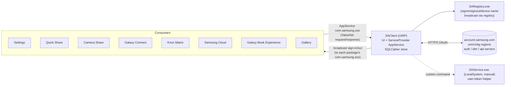

# 06 — Samsung Account (client + SSO hub)

## 1. Purpose

Sign-in, profile, devices, family group, terms/consent and security for the Samsung account on Windows, and — architecturally more important — the **single sign-on (SSO) hub** for every other Samsung app. Apps never handle Samsung credentials themselves; they ask the Account app (over AppService `com.samsung.sso`) for sign-in state and access tokens, and receive sign-in/sign-out broadcasts.

## 2. Packaging & deployment

| Item | Value |
|---|---|
| Package | `SAMSUNGELECTRONICSCO.LTD.SamsungAccount_1.26.6021.0_x64__3c1yjt4zspk6g` (276 files, 91 MB) |
| App | `SAClient.exe` / `SAClient.dll` (UWP, .NET Native 2.2, WinUI 2.8; 66 MB native image; REA could not admit CLI metadata — described from strings) |
| Capabilities | `packageManagement`, `userSystemId`, `runFullTrust`, `broadFileSystemAccess`, `confirmAppClose`, `localSystemServices`, `packagedServices`, `smbios`, `unvirtualizedResources`, `internetClient(Server)`, `privateNetworkClientServer`, `sharedUserCertificates`, `picturesLibrary`, `webcam`, `microphone` |
| Service | `SamsungAccountService` → `SAService\SAService.exe` (.NET Fx), **manual**, LocalSystem |
| Full-trust helper | `SARegistry\SARegistry.exe` with parameter groups `signin`, `signout`, `device_product_name` |
| AppServices | `com.samsung.sso` → `SamsungAccountService.ServiceProvider`; `com.samsung.sso.sshandler` → `SamsungAccountService.BnRServiceProvider` (backup & restore); `com.samsung.cloud.sync.v2` |
| Protocols | `saclient:` (ReturnResults optional, DesiredView useMore), `saclient.winui:` |
| Background tasks | `SamsungAccountBackgroundTasks.AppUpdateBGTask` (update task), `SACustomBGTask`, `BackgroundTaskManager` (systemEvent) |
| Publisher cache folder | `SHARED_ICONS_FOLDER` (profile images shared with other apps from the same publisher) |
| Libraries | `e_sqlcipher.dll` (SQLCipher-encrypted SQLite), `SACommon.dll` (.NET Standard 2.0, shared with service), `SALogger.dll`, WebView2, Win2D, Lottie |

## 3. Architecture

### 3.1 SSO contract (observed vocabulary)

- Token kinds handled: `access_token`, `refresh_token`, `sso_token`, `userauth_token`, `id_token`, `cloud_access_token`, `google_id_token`, `google_access_token`, with `token_type`, `access_token_expires_in`, `refresh_token_expires_in`, `is_access_token_requested`, `issue_upload_token_data`.
- Errors: `Invalid Access Token`, `Invalid Refresh Token`, `Invalid Auth Token`, `Invalid User Auth Token`.
- Header `x-osp-authToken`, `appKey`, `pkiPublicKey`.
- Clients identify by app ID (`Constants.GetClientAppId`); Settings uses `SASDK_WinUI` for this exchange; Quick Share / Camera Share / Continuity implement their own `SAClientAppServiceHandler`.
- Broadcast: consumers declare their own `com.samsung.sso` AppService so the Account app can push `OnBroadcastSignIn` / `OnBroadcastSignOut` (see `SASSOAppServiceHandler` in Continuity and Camera Share).
- `SARegistry.exe` additionally mirrors state to the registry (`BroadcastByRegistry`, `GetAndSetDeviceModel`, `GetFamilyName`, `GetHardwareID`) for non-packaged consumers (e.g. the Settings engine's `SamsungAccountEventListener`, registry `HKLM\SOFTWARE\Samsung\SamsungAccount`).

### 3.2 `SACommon.dll` (REA `ev_27c1fcfb491206590e522cf0c47d44ef9fdf60fc71b39f9c67ea64d548d53ef4`)

`Storage.MetaManager` (server URL registry: API, Find, Auth, IDM, sign-in, confirm-password URLs; China-specific routing `IsChineseCountry`), `PersistentMetaManager` (LocalSettings), `Server.AccountServerType/CloudServerType`, `Encryption.AESGCMDecryption` (`DecryptStringAESGCM`, `GenerateOTP`, `HashData`), `Base32` (nonce + user-ID decode), `Country.CountryMappingHelper` (MCC ↔ country), `Analytics`, `Constants.{PagePaths, ViewType, ServiceType, Consent}`.

### 3.3 `SAService.exe`

Minimal SCM service: `OnStart/OnStop/OnCustomCommand`, `WTSGetActiveConsoleSessionId`, `WTSQueryUserToken`, `GetCurrentUserSid` — a privileged helper invoked via custom control codes (manual start).

## 4. UI/UX design

Shell + pages (from .NET Native type-name strings): `ShellPage`, `SaPage`, `OnboardingPage`, `ProfileInfoPage`/`EditProfileInfo`, `DevicesPage`/`DeviceDetailsPage`/`RegisteredDeviceDetailsPage`, `SecurityPrivacyPage`, `RecentActivityPage`, `PersonalizedAdvertisingPage`, `PersonalizedAdsWithLocation`, `CustomizationServicePage`, family (`FamilyOnboarding`, `FamilyMembersList`, `FamilyMemberDetails`, `FamilyInvitePeople`, `FamilyEmailInvitation`, `FamilyQrInvitation`, `FamilyChildrenDevices(Empty)`, `ChildBlockedPage`), terms (`TnCPage`, `TnCReAgreeChild/Organizer`, `TnCGraduate(Initial)` — minor reaching majority, `SpecialTermsPage`), Korean identity verification (`NiceVerificationPage`, `NiceVerificationConfirmPage`), `AboutSamsungAccountPage`, `OpenSourceLicensesPage`, `WebViewViewModel` (WebView2 for web flows), developer tools (`DeveloperSettingsPage`, `PushTesterPage`). `webcam`/`microphone` capabilities support QR invitation scanning / verification.

Deep links: `com.samsung.parentalcontrols.family://{profile,requests,allrequests}`, `…family.V2://`, `com.samsung.samsungfind.launcher://default`, `com.samsung.account.profile_image`.

## 5. Data & state

- SQLCipher database in package LocalState (key management via `ProtectedData`/DPAPI and `IPasswordVault` references — exact key derivation unknown).
- `PersistentMetaManager` LocalSettings for server URLs and flags.
- Shared profile icon in publisher cache folder `SHARED_ICONS_FOLDER` (readable by all `3c1yjt4zspk6g` packages; Settings loads `\profile.png`).

## 6. Network endpoints

`https://us.account.samsung.com`, `https://stg-us.account.samsung.com`, `https://account.samsung.cn`, `https://account.samsung.com/membership/…`, `https://v3.account.samsung.com/policies/privacy-notices/latest`, `https://policies.account.samsung.com/terms`, `https://terms.samsungconsent.com/…`, `https://privacy.samsung.com`, `https://help.content.samsung.com/csweb/faq/search`, Korean service centre `https://www.samsungsvc.co.kr/{consult,login,reserve}`; Google sign-in `https://accounts.google.com/o/oauth2/v2/auth` with PKCE (`code_challenge`, scope `user.birthday.read`) in `SamsungAccountLibrary` (Welcome package copy).

## 7. Security & privacy observations

1. Central token broker: compromise of `SAClient` or a spoofed AppService caller would expose tokens for every Samsung service. AppService callers are identified by package family name (Windows-enforced), which is the main trust boundary.
2. Tokens cached client-side by consumers too (Quick Share `QSDatabase` stores SA login data and access tokens).
3. Local DB encrypted with SQLCipher (observed provider `e_sqlcipher`).
4. Broad capabilities (`packageManagement`, `broadFileSystemAccess`, `webcam`, `microphone`) for an account app.

## 8. Evidence

REA `SACommon` `ev_27c1fcfb…3ef4` (native boundary `ev_a0b32714…96d2`); `SAClient.dll` sha256 `1d203050…aedd`; strings `recon/native/SAClient.dll.txt`; dumps `recon/md/SamsungAccount/*`; manifest `recon/manifest_SAMSUNGELECTRONICSCO.LTD.SamsungAccount.txt`.

## 9. Unknowns

- Exact `com.samsung.sso` ValueSet keys/commands (in .NET Native code).
- SQLCipher key derivation.
- What `SAService` custom commands do.
