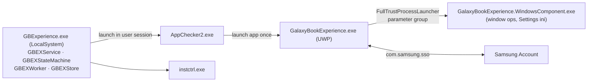

# 08 — Galaxy Book Experience (Samsung Welcome)

## 1. Purpose

Onboarding and discovery hub for Galaxy Book owners: introduces Galaxy features, recommends/installs Samsung apps, shows tips and notifications, and launches feature apps (Settings, Quick Share, Multi Control, …). A SYSTEM service ensures the app is launched for new users and checks app installation state.

## 2. Packaging & deployment

| Item | Value |
|---|---|
| Package | `SAMSUNGELECTRONICSCO.LTD.SamsungWelcome_3.9.4.0_x64__3c1yjt4zspk6g` (119 files, 203 MB) |
| App | `GalaxyBookExperience.exe` (UWP, .NET Native 2.2, WinUI 2.8, Store Engagement SDK) |
| Capabilities | `internetClient(Server)`, `privateNetworkClientServer`, `enterpriseAuthentication`, `sharedUserCertificates`, `userAccountInformation`, `userSystemId`, `packageQuery`, `runFullTrust`, `localSystemServices`, `packagedServices`, `confirmAppClose`, **`inputInjectionBrokered`**, `bluetooth` |
| Service | `GBExperience` (display "갤럭시 북 익스피리언스") → `WindowsService\GBExperience.exe` (native C++), auto, LocalSystem — observed *Stopped* |
| Service helpers | `WindowsService\AppChecker2.exe`, `WindowsService\instctrl.exe` (description "Samsung System Platform Engine"); copied to `C:\ProgramData\Samsung\GBExperienceSvc\Service\` with `cryptinfo.dat` |
| Full-trust helper | `Win32\GalaxyBookExperience.WindowsComponent.exe` (.NET) with parameter groups `ActivateWindow`, `DisableAlwaysOnTop`, `MaximizeWindow`, `SettingsContentIni`, `WindowCentralized` |
| AppServices | `ExtensionService`, `com.samsung.sso` |
| Protocol | `samsung-welcome:` |
| Background tasks | `GalaxyBookExperience.BackgroundTasks.NotificationBackgroundTask` (timer/systemEvent), `PurgeUnusedAssetsFromInstalledPackage`, `ServiceBT.LoggerBT.LoggerBG`, `Utils.UtilsBG` |

## 3. Architecture

### 3.1 Service (`GBExperience.exe`, sha256 `e45e23c8…72e0`)

Built on the shared `secsc` framework (`D:\Projects\NCSG21-GBEService\GBExperience\{GBEXOp, GBEXService, GBEXStateMachine, GBEXStore, GBEXWorker, main}.cpp`, `secsc\{SCComInitializer, SCCommon, SCLogger, SCNetStatus, SCService}.cpp`). Supports `--install` / `--uninstall`. State machine + worker launch `AppChecker2.exe` in the user context; persistent store `GBEXStore::SyncDB`; markers `C:\ProgramData\Samsung\GBExperienceSvc\launch.txt` and `installed.txt`; logs `GBExperienceSvc\Log\{AppChecker,GalaxyBookExperience}_YYYY-MM-DD.log`. Messages: "User mode detected and GBE has launched", "AppChecker launched", `sc.exe failure`.

### 3.2 Windows component (`GalaxyBookExperience.WindowsComponent.exe`)

`Program.SetOperations` dispatches the parameter group: `SamsungSettingsComponent` (copies the Settings INI to the package LocalFolder and sends it to the UWP — `CopyIniFileToLocalFolder`, `ReadSamsungSettingsFile`, `SendToUWP`), `ScreenActivationWindowComponent` (find window by caption, `SetForegroundWindow`, synthetic key press `keybd_event` to obtain foreground rights), `ScreenMaximizeWindowComponent`, `ScreenConfigComponent` (`DisableWindowAlwaysOnTop`, centre on monitor). `ProcessManagement.KillProcess`.

## 4. UI/UX design

UWP shell with Lottie, WebView2 and Win2D effects (manifest activatable classes); feature cards and tips; Store Engagement notifications; account sign-in through SSO. Window choreography (centre/maximise/foreground) is delegated to the Win32 component because UWP cannot manipulate other windows.

## 5. Security & privacy observations

1. `inputInjectionBrokered` capability plus `keybd_event` in the helper — used for focus-stealing workarounds (observed); broad capability for an onboarding app.
2. SYSTEM service launches user-session processes; files in `C:\ProgramData\Samsung\GBExperienceSvc\Service\` are executed by the service — directory ACLs not checked (unknown).
3. `instctrl.exe` carries the "Samsung System Platform Engine" description → shared installer-control component with doc 13.
4. `SamsungAccountLibrary.dll` in this package includes a Google OAuth (PKCE) flow requesting `user.birthday.read` (age verification for account creation; inferred).

## 6. Evidence

Manifest `recon/manifest_SAMSUNGELECTRONICSCO.LTD.SamsungWelcome.txt`; dumps `recon/md/SamsungWelcome/*`; strings `recon/native/GBExperience.exe.txt`; ProgramData `GBExperienceSvc`.

## 7. Unknowns

UWP page structure (.NET Native); `AppChecker2`/`instctrl` command contract; `cryptinfo.dat` format.
