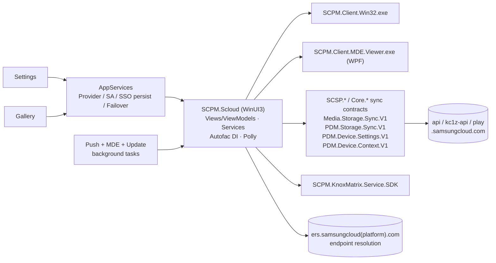

# 09 — Samsung Cloud Platform Manager (SCPM / "Samsung Cloud")

## 1. Purpose

Windows client of Samsung Cloud: account-linked sync providers (Gallery/media storage sync, device settings sync incl. Wi-Fi/Bluetooth), sync status viewer, MDE (multi-device experience) viewer/popups, push notifications, cloud web fail-over, and Knox Matrix integration. Other apps (Settings, Gallery, Account) use it through AppServices.

## 2. Packaging & deployment

| Item | Value |
|---|---|
| Package | `SAMSUNGELECTRONICSCO.LTD.SamsungCloudPlatformManag_2.2.5.0_x64__3c1yjt4zspk6g` (643 files, 305 MB) |
| Dependencies | Windows 10.0.18362, Windows App Runtime 2.4, VCLibs |
| Capabilities | `internetClient(Server)`, `privateNetworkClientServer`, `sharedUserCertificates`, `userAccountInformation`, `enterpriseAuthentication`, `userSystemId`, `packageQuery`, `smbios`, `runFullTrust`, `allowElevation`, `extendedBackgroundTaskTime` |
| App | `SCloud\SCPM.Scloud.exe` (.NET 8 WinUI 3; `SCPM.Scloud.dll` REA `ev_7658e91b94474f25e51cf18189d8c35caa4c56665c34a1e4fb8a5b4bf451a633`) |
| Full-trust | `Client.Win32\SCPM.Client.Win32.exe` (parameters `GetDeviceInformation`, `GetGallerySubscriptionInfo`, `OpenMdePopup`, `ZipLogFiles`), `Client.MDE.Viewer\SCPM.Client.MDE.Viewer.exe` (protocol `com.samsung.scpm.client.mde.viewer:`) |
| Protocols | `scloud:`, `com.samsung.scpm.cloud:` |
| AppServices | `com.samsung.sso` (`SamsungAccountAppService`), `com.samsung.sso.persist` (`SsoPersistSamsungAccountAppService`), `com.samsung.cloud.sync` / `com.samsung.cloud.sync.v2` (`ProviderAppService`), `com.samsung.cloud.cloudwebfailover` (`DeviceSettingsFailoverAppService`) |
| Background tasks | `PushNotification.InitializePushNotificationsBackgroundTask`, `PushNotificationBackgroundTask` (WNS push), `Mde.MdeBackgroundTask`, `OutOfProcess.Update.UpdateBackgroundTask`, `UpdateApplicationConfigurationBackgroundTask` (timer/systemEvent/update task) |
| Publisher cache | `SHARED_ICONS_FOLDER`, `SHARED_PKI_FOLDER` (PKI material shared across Samsung packages) |

## 3. Architecture

### 3.1 Assemblies

| Assembly | Role |
|---|---|
| `SCPM.Scloud.dll` | UI + services: `Com.Samsung.Scpm.Client.{Views, ViewModels, Services(.Settings/.Packages/.Network/.Launch), Activation, DependenciesInjectionModules, Resources.*}` |
| `Com.Samsung.Scpm.Client.AppServices.dll` | AppService + background task implementations |
| `SCPM.Core`, `SCPM.Client.Core`, `SCPM.Infrastructure(.WinUI)`, `SCPM.Tools(.WinUI)`, `SCPM.SDK`, `SCPM.Server.SDK`, `SCPM.Connectors.Appservice` | platform layers (DI via Autofac, resilience via Polly) |
| `SCSP.Media.Storage.Sync.V1` (largest, 1,738 strings), `Core.Media.Storage.Sync.V1` | gallery/media storage sync |
| `SCSP.PDM.Device.Settings.V1`, `SCSP.PDM.Device.Context.V1`, `SCSP.PDM.Storage.Sync.V1`, `SCSP.PDM.IntegrationSyncContracts` | PDM (personal data management) device settings/context sync |
| `SCSP.SyncViewer`, `SCPM.SyncViewer`, `Core.SyncViewer` | sync status UI (`Com.Samsung.SyncViewer.Ui.Domain.Processor`) |
| `SCPM.KnoxMatrix.Service.SDK` | client of Knox Matrix (doc 10) for E2EE keys/trust |
| `SCWindowsSDK_PAM(_KPS_LITE)`, `SCWindowsSDK_ODM_DOS(_PKI/_CONFIG_CLIENT/_RESOURCE)` | Samsung Cloud Windows SDK: PAM (device registration/token), ODM DOS (device online service; PKI) |
| `Samsung.OneUI.WPF` | MDE viewer UI |
| `CommonLoggerSDK`, `CommonLoggerSimpleLog`, SamsungAnalytics | logging/telemetry |

## 4. Network endpoints

`https://ers.samsungcloud.com/ers/v1/endpoints`, `…/viewer-country` (and `ers.samsungcloudplatform.com`, `stg-ers…`) — endpoint resolution service that returns regional API hosts; `https://api.samsungcloud.com`, `https://kc1z-api.samsungcloud.com`, `https://play.samsungcloud.com`, staging `stg-*`; `https://www.samsungcloud.com`; Account linking URL to `account.samsung.com/links?key=authorize…redirect_uri=https://support.samsungcloud.com/user/v2/tokens/access…` (gallery support flow).

## 5. Design notes

- **Endpoint indirection**: no hard-coded regional API host; ERS chooses per country.
- **Shared PKI folder** lets Samsung packages share device certificates without re-provisioning.
- **Fail-over AppService** (`cloudwebfailover`) lets Settings/other apps fall back to web flows.
- `allowElevation` + `ZipLogFiles` parameter group: elevated helper for log collection (inferred).

## 6. Security & privacy observations

- Syncs Wi-Fi and Bluetooth device data on behalf of Settings (doc 01) — cloud-side storage of network credentials when enabled.
- Publisher-shared PKI folder means any `3c1yjt4zspk6g` package can read it (by design of publisher cache folders).

## 7. Evidence / unknowns

REA `ev_7658e91b…a633` (native boundary `ev_7a9cfb59…d8f`); dumps `recon/md/SamsungCloudPlatformManag/*`; manifest file. Unknown: sync protocol payloads, PKI folder contents.
