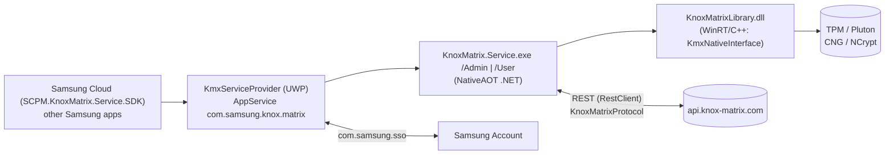

# 10 — Knox Matrix for Windows

## 1. Purpose

Windows member of Samsung's **Knox Matrix** cross-device trust chain: provisions a hardware-backed (TPM) device key, attests the PC to Samsung's Knox Matrix servers, and provides end-to-end-encryption (E2EE) key management to other Samsung apps (Samsung Cloud uses `SCPM.KnoxMatrix.Service.SDK`).

## 2. Packaging & deployment

| Item | Value |
|---|---|
| Package | `SAMSUNGELECTRONICSCO.LTD.KnoxMatrixforWindows_2.1.1.0_x64__3c1yjt4zspk6g` (55 files, 130 MB) |
| Capabilities | `internetClient(Server)`, `privateNetworkClientServer`, `enterpriseAuthentication`, `userAccountInformation`, `publisherCacheFolders`, `broadFileSystemAccess`, `runFullTrust`, `extendedBackgroundTaskTime` |
| App | `KmxServiceProvider.exe` / `KmxServiceProvider.dll` (27 MB native; UWP entry `KmxServiceProvider.App`, no visible UI) |
| AppServices | `com.samsung.knox.matrix`, `InProcessAppService`, `com.samsung.sso` |
| Background tasks | `KmxAppService.EntryPoint`, `KmxAppService.SAEvents` (sign-in events), `KmxAppService.UpdateChecker` (timer/systemEvent); other activatable classes `AppServiceImpl`, `AppDataContainer`, `PeriodicTaskRunner`, `SamsungAnalyticsLogger` |
| Full-trust process | `KnoxMatrix.Service\KnoxMatrix.Service.exe` with parameter groups `/Admin` and `/User` |
| Publisher cache | `encrypted_files` |
| Native lib | `KnoxMatrix.Service\KnoxMatrixLibrary.dll` (WinRT component `KnoxMatrixLibrary.Kmx`, `IKmxStatics`), debug CRT copies (`vccorlib140d_app.dll`, `vcamp140d_app.dll`) shipped |

`KnoxMatrix.Service.exe` (104 MB, sha256 `82f96f01…d9ac`) is a **.NET NativeAOT single-file** image: embedded `KnoxMatrix.Service.deps.json` / `runtimeconfig.json`, assemblies `KnoxMatrix.Service.dll`, `KnoxMatrix.Library.dll` (+ PDB names), and even a `KnoxMatrix.Service.Tests` namespace.

## 3. Architecture

### 3.1 Components (type names recovered from the NativeAOT image)

| Area | Types |
|---|---|
| Service | `KnoxMatrix.Service.{KnoxMatrixRequestHandler, RestRequestHandler, RestClient, KmxServiceSamsungAnalytics}` |
| Protocol | `KnoxMatrix.Library.Protocol.{Command, KnoxMatrixProtocolClient, KnoxMatrixProtocolHandler, KnoxMatrixProtocolData}`, `KnoxMatrixToApplication` |
| Crypto | `KmxCryptoManager`, `KmxCryptoProcessor`, `KmxBcryptWrapper`, `KmxSymmetricCrypto`, `KmxWrappingKey`, `KmxKeys`, `KnoxMatrixDeviceKey` |
| E2EE | `KmxE2EEManager`, `KmxE2EEAdmin`, `KmxE2EEUser` (matching `/Admin` and `/User` process modes) |
| Account | `KnoxMatrix.Library.Account.{AccountManager, CertificateManager, FileHelper, KmxSAManager}`, `KmxSAData` |
| Native bridge | `KmxNativeInterface`, `KnoxMatrixNativeInterface`, `KnoxMatrixLibrary_IKmx(Statics)` |
| TPM attestation | WinRT APIs referenced: `DecryptTpmAttestationCredentialAsync`, `RequestAttestedVirtualSmartCardCreationAsync` (TPM key attestation / credential activation) |

### 3.2 Design rationale (inferred)

- Split `/Admin` vs `/User`: machine-level device key operations need elevation, per-user E2EE keys live in the user context.
- NativeAOT avoids a .NET runtime dependency and complicates tampering.
- `encrypted_files` publisher cache folder stores wrapped key blobs shareable with sibling packages.

## 4. Endpoints

`https://api.knox-matrix.com/` (prod), `https://api.stg.secknoxmatrix.com/`, `https://api.dev.secknoxmatrix.com/` (non-prod hosts present in the shipped binary).

## 5. Security & privacy observations

- Hardware-rooted keys via TPM; attestation identifiers sent to Samsung.
- Dev/staging hosts and a test namespace compiled into the production binary; debug VC runtime DLLs shipped.

## 6. Evidence / unknowns

Strings `recon/native/KnoxMatrix.Service.exe.txt`; manifest `recon/manifest_SAMSUNGELECTRONICSCO.LTD.KnoxMatrixforWindows.txt`. Unknown: protocol message formats, which TPM key hierarchy is used, admin elevation path.
