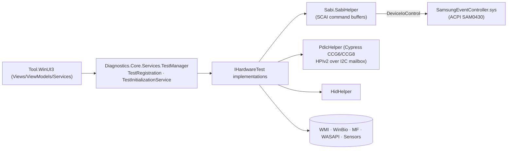

# 11 — Samsung PC Diagnostics

## 1. Purpose

Self-service hardware test suite for Galaxy Books (used by users and service centres): runs per-component tests and talks directly to firmware (SABI/SCAI) and the USB-PD controller for results Windows cannot provide.

## 2. Packaging & deployment

| Item | Value |
|---|---|
| Package | `SAMSUNGELECTRONICSCO.LTD.PCDiagnostics_1.0.24.0_x64__3c1yjt4zspk6g` (667 files, 414 MB) |
| Entry | `PCDiagnostics.exe` (.NET 9 apphost, WinUI 3 / Windows App SDK; sha256 `234d2682…a4e5`), `RestartAgent.exe`, `createdump.exe` |
| Capabilities | `internetClient`, `runFullTrust`, **`allowElevation`** |
| Protocol | `com.samsung.pcdiagnostics:` |
| Assemblies | `PCDiagnostics.dll` (UI, REA `ev_d3fdf5077c8017272b8d25269839b64cb057e7c11ea520d624e3b7810c701476`), `Diagnostics.Core.dll` (tests + hardware access), `Diagnostics.Resources.dll`, LiveCharts2 (SkiaSharp), `SCWindowsSDK_PAM`, `SCWindowsSDK_ODM_DOS(_PKI/_CONFIG_CLIENT/_RESOURCE)`, SamsungAnalytics, `Samsung.OneUI.WinUI` |

## 3. Architecture

## 4. Test catalogue (`Diagnostics.Core.Tests`)

`ACAdapterTest`, `AmbientLightTest`, `BatteryTest`, `BluetoothTest`, `CameraTest`, `CellularTest`, `CoolingFanTest`, `CpuTest`, `DisplayTest`, `FingerprintTest` (WinBio), `KeyboardTest` (+ `CopilotKeyChecker`, `FnLockKeyChecker`, low-level hook `Win32.HookProc`), `MainboardTest`, `MemoryTest`, `MicTest`, `MotionSensorTest`, `SpeakerTest`, `SPenTest`, `StorageTest`, `TouchpadTest`, `TouchScreenTest`, `WifiTest`. Results: `TestResult`/`ITestResult`; registry `TestRegistration`.

## 5. Firmware interfaces

- **SABI** (Samsung BIOS Interface): `Sabi.SabiHelper.{SendCommand, GetScaiCommand, GetScaiResponse, IsValidResponse, CheckAABB, FindSamsungEventController, DeviceIoControlAsync}`; command structs `BaseSabiCommand`, `SabiCommand`, `ExtendedSabiCommand`, `ScaiCommand/ScaiResponse`; enums `SabiFunctions`, `SubCmdId`, `BatteryData`, `PowerSavingMode`, `PerformanceMode`, `EtiquetteMode`, `FanFastMode`; `DeviceSupportInfo{FingerprintSupport, TouchScreenSupport, IrCameraSupport, KbdBacklightSupport}`. Error strings: "SABI init fail", "SabiResponse error, completion flag = …", "Secured device control Sabi func not supported", "Titan5-15 fingerprint support check from SABI".
- **USB-PD controller**: `PdicHelper.PdicCypressCcg6/Ccg8` (HPIv2 registers: device mode, PD status, current PDO/RDO, VSafe5V PDO) through a `MailBox` (`WriteRegister/ReadRegister/BlockIo`, global lock, update mode) over I2C — used by `ACAdapterTest`.
- **HID**: `Diagnostic.Core.Helpers.HidHelper` (`hid.dll`).

## 6. Design notes

- Plugin-style test registry with per-device support probing via SABI so unsupported tests are hidden.
- `allowElevation` because driver access (`SamsungEventController` interface is Admin/SYSTEM-only per INF) requires admin.
- Charts via LiveCharts2 for battery/CPU/fan graphs.

## 7. Security & privacy observations

- Runs elevated and issues raw EC/PD-controller commands; `MailBox.EnterUpdateMode` suggests PD firmware update-mode access exists in code (inferred, not observed in UI).
- Keyboard test installs a low-level keyboard hook while running.

## 8. Evidence / unknowns

REA `ev_d3fdf507…01476`; dumps `recon/md/PCDiagnostics/*`. Unknown: SABI function IDs and CCG register map values.
