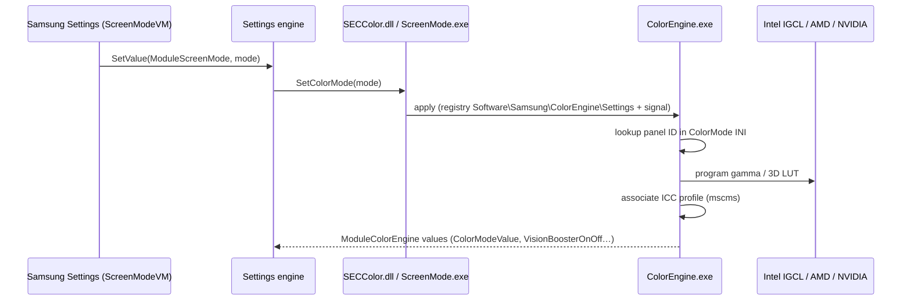

# 12 — Color Engine & Display Profile

## 1. Purpose

Panel-specific colour management for Galaxy Book displays (AMOLED and LCD): colour modes (Auto, AMOLED native, Vivid/Dynamic, Natural, Standard, sRGB, DCI-P3, Adobe RGB, Photo, Reading), colour tone (warm/cool), black equaliser, HDR+ / video enhancement ("movie on/off"), Vision Booster, and ICC profile registration. Front-end is Samsung Settings (doc 01, `ModuleScreenMode`/`ModuleColorEngine`); this doc covers the engine.

## 2. Components & deployment

| Component | Location | Role |
|---|---|---|
| `SamsungColorEngineService.exe` | `C:\Program Files\Samsung\ColorEngine\` — service "Samsung ColorEngine Service", auto, LocalSystem | Supervisor: launches `ColorEngine.exe` in the user session (`WTSAPI32`, `USERENV`), watches `explorer.exe`, copies vendor INIs (`QcColorMode.ini`, `QcConfigs.ini`, `QcConfigsV4.ini` for Qualcomm; Intel/AMD equivalents) to `C:\ProgramData\ColorMode\CeData`, reads `Software\Samsung\ColorEngine\Settings`. Knows legacy name `ColorEngineSvc.exe`. |
| `ColorEngine.exe` (sha256 `eaa0d8ff…7449`) | same folder; a copy in `C:\ProgramData\Samsung\ColorEngine\` | Per-user colour engine: GPU-vendor back-ends (`CIntelGraphic`, `CIntelGraphicIGCL` — Intel Graphics Control Library), gamma/3D-LUT programming, mode switching (`SetColorMode() - MODE_*`), video detection via Media Foundation sensor/MF APIs (`MFPlat`, `MFSENSORGROUP`) and WinMM sounds (`movie_on.wav`/`movie_off.wav`), reads `HKCU\Software\Microsoft\Windows\CurrentVersion\VideoSettings` (Windows HDR/video playback settings), `mscms` ICC calls. Falls back to `.\GammaLUTPatch.exe`. |
| `SetParam3264.exe` | same | "ColorEngine Parameter Setting" CLI. |
| `SECColor.dll` | Settings DriverStore component | Client library exporting `GetColorMode`, `SetColorMode`, `SetColorModeSave`, `Get3DLutMode`; talks to the Settings engine pipe `\\.\pipe\{9187E7E8-…}_…` (`WaitNamedPipeW`, `SetNamedPipeHandleState`) and the `SOFTWARE\Samsung\SamsungSettings(Extension)` registry. |
| `DisplayProfileRegister.exe` (sha256 `53ddc6a9…acb5`) | `C:\Program Files\Samsung\DisplayProfile\` and `C:\ProgramData\ColorMode\` | Installs/associates ICC profiles per mode (`%s.icm`, `%sA.icm` Adobe, `%sP.icm` P3, `%sS.icm` sRGB, `%sSettings.icm`; here `SDC4189*.icm` — Samsung Display panel ID) via `InstallColorProfile`, `DisassociateColorProfileFromDevice`; reads `IntelColorMode.ini`/`AmdColorMode.ini`/`AmdColorModeGamma.ini`/`AmdColorToneCurve.ini`, `.\lut\%s`; logs to `C:\ProgramData\ColorMode\log.txt`. |
| `DisplayProfile.xml` + `DisplayProfileTaskAdd.bat` | `C:\ProgramData\ColorMode\` | Task definition "InitDisplayProfile": **LogonTrigger**, group `S-1-5-32-545` (Users), RunLevel `HighestAvailable`, action `DisplayProfileRegister.exe`; installer runs `schtasks /create /XML DisplayProfile.xml /tn InitDisplayProfile`. (Task not currently registered on this host.) |

## 3. Data model (ColorMode INIs)

`C:\ProgramData\ColorMode\{IntelColorMode.ini, IntelColorToneCurve.ini, IntelConfigs.ini, IntelConfigsV4.ini}` + `CeData\` copies. Header `[VERSION] Version = 5.5.1.1 ; NX15 Update2`. Sections per mode (`[MODE_NOEFFECT]`, …); keys are **panel model IDs** (e.g. `ATNA60CL09-`, `ATNA40CU07-` Samsung Display AMOLED; `KD156N2030A`, `N156HGA-EA3`, `NV140FHM-NS` LCDs; EDID mfg/product `7F36_1418`) with a slash-separated parameter vector `0/0/0/50/50/50/100/100/100/0/0/A/U/N/N/N/Default` — interpreted (inferred) as RGB offsets, RGB gains (50 = neutral), RGB maxima, two flags, panel type letters, and a profile name. Tone curves and 3D LUTs in `*ToneCurve.ini`, `*V43DLut.ini`, `*3DLutGamma.ini`.

## 4. Flow

Log evidence: `SetColorMode() - MODE_AMOLED_NATIVE / MODE_AUTO / MODE_P3 / MODE_ADOBERGB / MODE_NATURAL` transitions in `C:\ProgramData\ColorMode\log.txt`.

## 5. Security notes

- A copy of `ColorEngine.exe` in `C:\ProgramData\Samsung\ColorEngine\` and DLLs in `C:\ProgramData\ColorMode\` (`msvcp140.dll`, `vcruntime140.dll` next to `DisplayProfileRegister.exe`) — ProgramData defaults allow users to create files; if the service or an elevated task executes from these directories, ACLs matter (not checked; recommend `icacls` review).
- Logon task runs with highest available privileges for Users group members.

## 6. Evidence / unknowns

Strings `recon/native/{ColorEngine,SamsungColorEngineService,SetParam3264,DisplayProfileRegister,SECColor}.*.txt`; files under `C:\ProgramData\ColorMode`. Unknown: exact INI vector semantics; IGCL call sequence.
