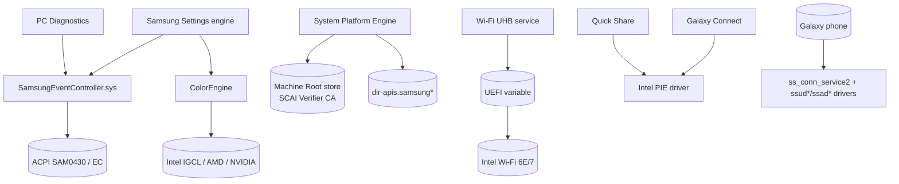

# 13 — Platform Engine, Drivers & Connectivity

Covers the firmware/OS-level pieces the apps depend on: System Platform Engine, the SCAI kernel driver, the Wi-Fi UHB (6 GHz) UEFI configuration service, and the mobile-connectivity USB drivers / services.

## 1. Samsung System Platform Engine (SPE)

| Item | Value |
|---|---|
| Binary | DriverStore `systemplatformenginecomp.inf_amd64_…\SystemPlatformEngine.exe` (sha256 `b2d829d8…1a72`), native C++ |
| INF | `systemplatformenginecomp.inf` (SoftwareComponent, `SWC\SAM0428&S01_SSPE`, v1.0.23.0 2025-12-03, `PnpLockdown=1`) + extension `systemplatformengineext.inf` (`ACPI\SAM0428/0429/0430`) |
| Service | `SamsungPlatformEngine` (ServiceType `0x110` = own-process interactive-ish, auto-start) created by the INF; `ServiceBinary=%13%\SystemPlatformEngine.exe`; version in `HKR\Parameters\Version` |
| Data file | `DirIF.sec` (copied alongside) |
| Build | `C:\Git\pc-system-platform-engine\SystemPlatformEngine\…` |
| Deps | WinHTTP, bcrypt, WS2_32, CRYPT32, spdlog (daily file sink) → logs `C:\ProgramData\Samsung\SystemPlatformEngine\Log\SystemPlatformEngine_YYYY-MM-DD.log` |

### 1.1 Tasks (observed C++ class names + log)

- `TaskDIR` + `DirIF` — **DIR** (Device Information Registration / "dir-apis") client: builds OAuth-style signed requests (`DirIF::{BuildAuthorization, GenerateConsumerKey/Secret/Passwd, GenerateSignature, GenerateDigestHex, GenerateCryptUniqueNumber}`), gathers system info from file/registry/WMI and MBN (modem) info, posts to Samsung. Endpoints: `https://dir-apis.samsung.com.cn`, `https://dir-stg-apis.samsungdiroute.net`. Gated on EULA ("TaskDIR] EULA was not loaded" / "Not processed EULA" in log) and NTP time (`NtpHandler`, "TaskPD] NTP enabled: false").
- `TaskInstallPC` / `TaskInstallPrivateCert` — installs the **SCAI verifier certificate** into the machine Root store: strings `certutil.exe -addstore root "…"`, `Samsung Electronics SCAI Verifier CA`; log "TaskInstallPC] No need to install SCAI cert" (already present — `CN=Samsung Electronics SCAI Verifier CA` is in LocalMachine\Root, valid to 2099). Registry `SYSTEM\CurrentControlSet\Services\SamsungPlatformEngine`; mutex `Global\WmiAcpiInterfaceMutex`.
- `TaskPurchaseDate` — determines/records purchase date (warranty).
- `TaskPD` — checks BIOS OEM strings ("No need to check BIOS OEMString[2]").

### 1.2 Design / security

- SPE is the component that establishes machine-to-Samsung device identity (DIR) and trust (SCAI CA). It runs as SYSTEM and makes outbound HTTPS to Chinese and global DIR hosts.
- **S-2**: ability to add a root CA valid until 2099 (`certutil -addstore root`). The CA is used to verify Samsung "SCAI" payloads/apps; a root CA with a 76-year lifetime is a broad trust anchor. Observed present; installation path observed in code + log.

## 2. SCAI kernel driver (`SamsungEventController.sys`)

| Item | Value |
|---|---|
| File | `C:\Windows\System32\drivers\SamsungEventController.sys` (sha256 `3929193d…ab11`), KMDF 1.27, `ForceIntegrity`+`ControlFlowGuard` |
| INF | `samsungeventcontroller.inf`, `ACPI\SAM0430` / `ACPI\SAMB430`, demand-start, `LoadOrderGroup=Extended Base` |
| Device security | `HKR,,Security,,"D:P(A;;GA;;;BA)(A;;GA;;;SY)"` — GENERIC_ALL to Administrators and SYSTEM only |
| Interfaces | imports `cng.sys` (`BCryptVerifySignature`, `BCryptImportKeyPair`, hashing), WDFLDR; strings "SCAI Client", `DEVICE_CONTEXT`, `ACPI_NOTIFICATION_CONTEXT`, certificate-chain error strings ("The certificate validity has expired", "revoked (is on a CRL)", "Common Name (CN) does not match") |

Role: bridges ACPI SCAI firmware events (hot-keys, battery, lid, SCAI notifications) to user mode and exposes a `DeviceIoControl` command channel used by Samsung Settings' engine/service (doc 01) and PC Diagnostics' SABI helper (doc 11). The driver verifies signatures with CNG (`BCryptVerifySignature`) — consistent with the SCAI verifier CA (doc 13 §1.1) authenticating commands/payloads (inferred).

## 3. Wi-Fi UHB (6 GHz) UEFI configuration service

| Item | Value |
|---|---|
| Binaries | DriverStore `samsungwificomponent.inf\SamsungWiFi_UHB_Setting_Service.exe` (desc "PTPFilterService"), `UEFICfg.exe` |
| INF | `samsungwificomponent.inf` → `SWC\VID_8086&PID_0001` (Intel Wi-Fi), service "Samsung WiFi UHB Setting Service" (`0x110`, auto); extension `samsungwifiextension.inf` matches Intel Wi-Fi PCI IDs (AX/BE: Mars/Venus/RPL/MTL/LNL/ArL) and binds the component via `SWC\VID_8086&PID_0001` |
| Build | `C:\Code\UEFICfgService_1.0.1.4\DCH_PTPFilter-master\…` |
| Registry | `SOFTWARE\Samsung\PTPService`; also `PTPFilterService.exe` legacy name; references `winlogon.exe`, `SetEnvironmentVariableW` |

Role: writes a UEFI variable (`UEFICfg.exe`) that unlocks/configures 6 GHz (UHB — Ultra-High-Band) operation for the Intel Wi-Fi adapter per regulatory domain. "PTP filter" = a lightweight filter/companion to the Intel Wi-Fi stack. (6 GHz enablement commonly needs a platform/BIOS signal; this service provides it — inferred.)

## 4. Mobile connectivity (USB drivers + ss_conn)

| Item | Value |
|---|---|
| Location | `C:\Program Files\Samsung\USB Drivers\` (329 files, 59 MB) — historical Samsung USB driver bundle (`03_Swallowtail` … `25_escape`, `27_ssconn`, `28_ssconn2`) covering modem/ADB/NCM/RMNET/OBEX across chipset generations; `lang\<lcid>\lang*.dll` localisation; `Uninstall.exe`, `DIFxAPI.dll`, `dgderapi.dll` |
| Active drivers (this host) | `ssudbus2.sys` (SAMSUNG USB Composite Device, `dg_ssudbus`), `ssudmdm.sys` (modem), `ss_conn_usb_driver2.sys` ("MSS CS Connectivity USB driver") |
| Services | `ss_conn_service` (`27_ssconn\conn\ss_conn_service.exe`) and `ss_conn_service2` (`28_ssconn2\…`), both "SAMSUNG Mobile Connectivity Service [V2]", auto, LocalSystem; log `C:\ProgramData\Samsung\MSSCS\connsvc2-*.log` |
| Internals | boost::asio-based USB device manager (`_CONNSVC_USB_DEVICE`, deadline timers, `\dev\ssusbcon`), CM/SetupDi device enumeration, `RegisterDeviceNotificationW`, `DeviceIoControl` |

Role: host-side transport for Samsung phone connectivity (Smart Switch / Kies-style device comms, DeX, tethering). `ss_conn_service2` is the current generation; the giant multi-generation `.sys` set ships for compatibility. The `ssud*`/`ssad*` modem/ADB drivers also back the Quick Share / Continuity / Camera Share device links when a phone is tethered over USB (inferred; those features prefer wireless).

## 5. Audio/graphics driver extensions (context)

DriverStore also holds Samsung DCHU audio/mic extensions (`hdxsstsamsung.inf` Realtek+Samsung, `hdx_samsungext_*`, `intcdmicext*_samsung_*`, `dolby_wrap`) and the SEC monitor/scanner INFs (`sec_mon7`, `secesclscan`). These are OEM audio tuning (Dolby/“Samsung Audio”), not part of the app suite, but share the Samsung provider and the DCHU extension pattern used by Settings/SPE.

## 6. Dependency map (who calls the firmware)

## 7. Security & privacy observations

1. **S-2** root-CA install by SPE (see §1.1).
2. SPE sends device/modem/system info to DIR endpoints (one in `.cn`), gated on EULA; identity signing done locally.
3. SCAI driver restricts its interface to Admin/SYSTEM and verifies signatures in kernel (good); all unprivileged EC access must go through the Settings service/engine.
4. Wi-Fi UHB service writes UEFI variables as SYSTEM.
5. Large legacy USB driver surface (kernel modem/network drivers for many chipsets) increases attack surface even when unused.

## 8. Evidence / unknowns

- SHA-256: `SystemPlatformEngine.exe b2d829d8…1a72`, `SamsungEventController.sys 3929193d…ab11`, `DisplayProfileRegister.exe` (doc 12).
- Strings: `recon/native/{SystemPlatformEngine,SamsungEventController.sys,SamsungWiFi_UHB_Setting_Service,ss_conn_service}.txt`; INFs under `C:\Windows\System32\DriverStore\FileRepository\`; logs `C:\ProgramData\Samsung\{SystemPlatformEngine,MSSCS}`.
- Unknowns: SCAI DeviceIoControl IOCTL codes and payload signing scheme; DIR request contents; which UEFI variable the UHB service writes; `DirIF.sec` format.
